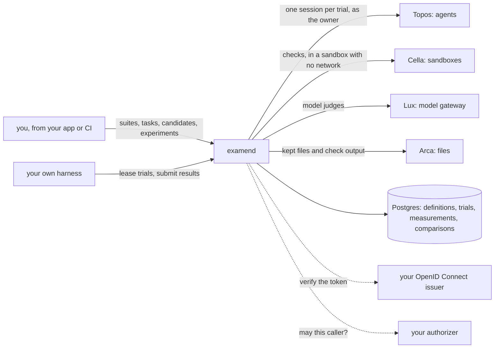

# Examen

**A service that runs experiments on agents and tells you what actually
changed.** Describe the tasks once, name the systems to try them with,
and say how many times each combination runs. Examen starts every run
through the services that already run agents and sandboxes, or hands it
to your own harness, grades what each run produced, and compares the
results: every number comes with its interval, every difference with a
test corrected for how many were made, and every comparison names what
else differed besides the thing you meant to change.

This repository is the whole service, `examend`, and anyone can run it.

[](https://github.com/latere-ai/examen/actions/workflows/verify.yml)
[](https://github.com/latere-ai/examen/releases)
[](go.mod)
[](LICENSE)

The name is Latin for the tongue of a balance, the pointer that shows
which way it tips.

## The problem

Change a model, an agent's instructions or its tools, and the same
question comes back: is it better now? One run says little, because an
agent given the same task twice does different things. Ten runs each
say more, but a difference between 5 of 10 and 9 of 10 can still be
chance, a dozen metrics read at once will show a "significant" change by
luck alone, and two runs that differ in the model that actually served
them, or in the image they ran in, are not comparing what you think.

Examen makes that loop declarative and keeps the arithmetic honest:

- **Rollouts, not anecdotes.** Each combination runs N times, and the
  run-to-run spread is measured, so a difference within the noise is
  reported as noise.
- **Comparisons that say what they compare.** Every run is pinned to its
  agent version or harness configuration, the model asked for and the
  model that served, the image, and the task. When two sides differ in
  more than one of those, the result says so.
- **Planned tests stay planned.** Comparisons declared before any trial
  runs are corrected together; one asked for afterwards is marked
  exploratory and never headlined.
- **Graders you can trust over time.** Checks run in a sandbox with no
  network. A model judge is pinned to its model and prompt, and grading
  again never overwrites an earlier grade.
- **Claims are not findings.** A value your harness reports about
  itself is kept and shown, and never given a verdict.

Examen runs no agent, sandbox or model call itself. It defines the
experiment, asks the services you name to run each trial as the
experiment's owner, and records what comes back.



Every service but Postgres and an issuer is optional. With none of
them, Examen runs experiments whose trials your harness runs, and
imports the runs of a study you already made.

## An experiment, end to end

Here `$EXAMEN` is a running `examend`'s API root, such as
`http://localhost:8080/v1`, and `api` is `curl` with your bearer token;
[Running it locally](docs/local.md) sets up both. Define what to
measure and the two systems to compare, applied by name and referred to
by digest so an experiment records exactly what it ran:

```sh
METRIC=$(api -X PUT $EXAMEN/metrics/passed -d '{
  "type": "binary", "aggregate": "rate", "direction": "higher_is_better"}' | jq -r .digest)
TASK=$(api -X PUT $EXAMEN/tasks/capital-of-france -d '{
  "instruction": "What is the capital of France? Answer with the city name alone."}' | jq -r .digest)
SUITE=$(api -X PUT $EXAMEN/suites/geography -d "{\"tasks\": [\"$TASK\"],
  \"metrics\": [\"$METRIC\", \"builtin:completed\"], \"primary_metric\": \"$METRIC\"}" | jq -r .digest)

A=$(api -X PUT $EXAMEN/candidates/my-agent-v1 -d '{"kind": "external",
  "external": {"harness": "my-harness", "version": "1.0.0", "flags": {"prompt": "terse"}}}' | jq -r .digest)
B=$(api -X PUT $EXAMEN/candidates/my-agent-v2 -d '{"kind": "external",
  "external": {"harness": "my-harness", "version": "1.0.0", "flags": {"prompt": "step-by-step"}}}' | jq -r .digest)
```

Run ten trials of each:

```sh
EXP=$(api -X POST $EXAMEN/experiments -d "{\"suite\": \"$SUITE\",
  \"candidates\": [\"$A\", \"$B\"], \"trials\": 10, \"budget\": {\"name\": \"local\"}}" | jq -r .id)
```

Your harness leases trials with `POST /experiments/{id}/work/lease`,
runs each one, and submits its outcome and values with
`POST /trials/{id}/submit`. Each cell deals one smoke trial first, so a
broken setup fails once rather than ten times. Once the experiment
completes, its comparison of the second candidate with the first is
final. Its suite-level result for `passed`, abridged:

```json
{
  "metric_name": "passed",
  "candidate": { "n": 10, "value": 0.9, "interval": [0.596, 0.982] },
  "reference": { "n": 10, "value": 0.5, "interval": [0.237, 0.763] },
  "delta": 0.4,
  "p": 0.1409,
  "verdict": null,
  "reason": "p = 0.14 on values the external harness reported itself: not a finding, and outside the corrected family",
  "confounds": [{ "name": "self_reported", "tasks": ["capital-of-france"], "candidate": 10, "reference": 10 }]
}
```

Ten trials do not settle 50% against 90%: Boschloo's exact test gives
`p = 0.14`. And the values are the harness's own claim, so they get no
verdict however small `p` is. Grades from Examen's own checks and
judges, on trials it ran, are the ones that do.
[Running it locally](docs/local.md) is this walkthrough with every
command, against a local `examend`.

## What works today

| | |
|---|---|
| **Suites, tasks, metrics, graders and candidates** as versioned objects: applied by name, identified by digest, never changed in place | works |
| **Your own harness**: it leases trials, renews and submits them, smoke trials first; a failure of the infrastructure is retried, and a cell whose smoke keeps failing is parked until you retry it | works |
| **Imported runs** of a study you already made, with their past times and declared harness version | works |
| **Agent candidates** (`topos`): each trial is one unattended [Topos](https://github.com/latere-ai/topos) session of a pinned agent version, on its model and reasoning level, created as the experiment's owner; its log, model requests and kept files are the evidence, and its cost and tokens are read from them | works, with Topos and a minter |
| **Checks** in a [Cella](https://github.com/latere-ai/cella) sandbox with no network, their output kept in [Arca](https://github.com/latere-ai/arca), and **model judges** through [Lux](https://github.com/latere-ai/lux), pinned to their model and prompt, grading agent candidates' trials | works, with Cella, Arca, Lux and a key endpoint |
| **The experiment's own model Key** for your harness, drawn on the experiment's Budget, with each trial's cost and the model that served it read back | works, with a key endpoint |
| **The analysis**: per-cell summaries with 95% intervals, Boschloo's exact test and studentized permutation tests, the primary result tested alone and every other result corrected together by Benjamini and Hochberg, a verdict and a plain reason for each, and the confounds; recomputed as trials arrive, and identical on every machine | works |
| **Declared comparisons**, fixed before any trial runs and corrected together, over two candidates, two tasks, a task's factors or any other cell variable, and a declared test of independence | works |
| **Label metrics**: a judge's labels tested as distributions, per task and stratified across tasks, and how often a candidate repeats one answer | works |
| **Interleaved scheduling**: trial `i` of every cell runs in one time window | works |
| Grading your harness's or imported trials, agent judges, annotation queues, canonicalizers, a configured decline judge and judges of a candidate as a whole | not built; an experiment that needs one is refused at create |
| **Program candidates** in sandboxes, the HTTP runner, and built-in comparators that score outputs against reference answers | not built |
| **Bars, reports, dataset export and publishing**; a benchmark's rank intervals are computed by the analysis and not served | not built |
| **Event delivery** | not built; `EXAMEN_EVENTS_URL` refuses the start |
| **Kubernetes manifests** | not in the repository; [Configuration](docs/configuration.md) lists what a deployment needs |

An experiment that needs a service this installation does not have is
refused `422 core_not_configured`, naming the service, never accepted
and left to wait. [Concepts](docs/concepts.md) explains each part, and
the [changelog](CHANGELOG.md) says what each release added.

## Try it

[Running it locally](docs/local.md) starts `examend` on your machine
with Postgres and a local issuer in containers, runs the experiment
above with a stand-in harness, and reads the results. You need Go 1.27
or newer and Podman or Docker.

```sh
make build   # out/examend
make         # the quality gate
```

## Install it

Every release publishes the image `ghcr.io/latere-ai/examend:<tag>` for
linux/amd64 and linux/arm64, signed, with a bill of materials;
[SECURITY.md](SECURITY.md#supply-chain) shows how to check it. You
supply Postgres 16 or newer and an OpenID Connect issuer. Run
`examend migrate` before each new version's `examend serve`.
[Configuration](docs/configuration.md) covers every variable, what each
service adds, the probes and telemetry.

## Documentation

| | |
|---|---|
| [Running it locally](docs/local.md) | an experiment against a local `examend`, every command shown |
| [Concepts](docs/concepts.md) | the objects, how each kind of candidate runs, grading, and what the analysis computes |
| [Configuration](docs/configuration.md) | every `EXAMEN_*` variable, what each service adds, the database, the image and the probes |
| [Writing an authorizer](docs/authorizer.md) | the question Examen asks, the answer and its limits, and the owner policy |
| [API reference](api/openapi.yaml) | every route, request, response and error code, as OpenAPI 3.1 |

[`specs/`](specs/README.md) holds the design of each component with the
reasoning behind it.

## What it is not

Not a benchmark dataset and not a leaderboard. Not an agent runtime,
sandbox, model gateway or HTTP client of the APIs it evaluates: Examen
calls the services that run things through their APIs, and an API under
evaluation is called by a program inside a sandbox, never by Examen
itself. Who may run what is answered by an authorizer you write, or by
a built-in policy that lets each owner act on their own objects.

## Contributing

[`CONTRIBUTING.md`](CONTRIBUTING.md) is how to build and test a change
and where code belongs. [`SECURITY.md`](SECURITY.md) is what the
project protects and where to report a vulnerability; please do not
open an issue for one.

## License

Apache-2.0. See [LICENSE](LICENSE).
