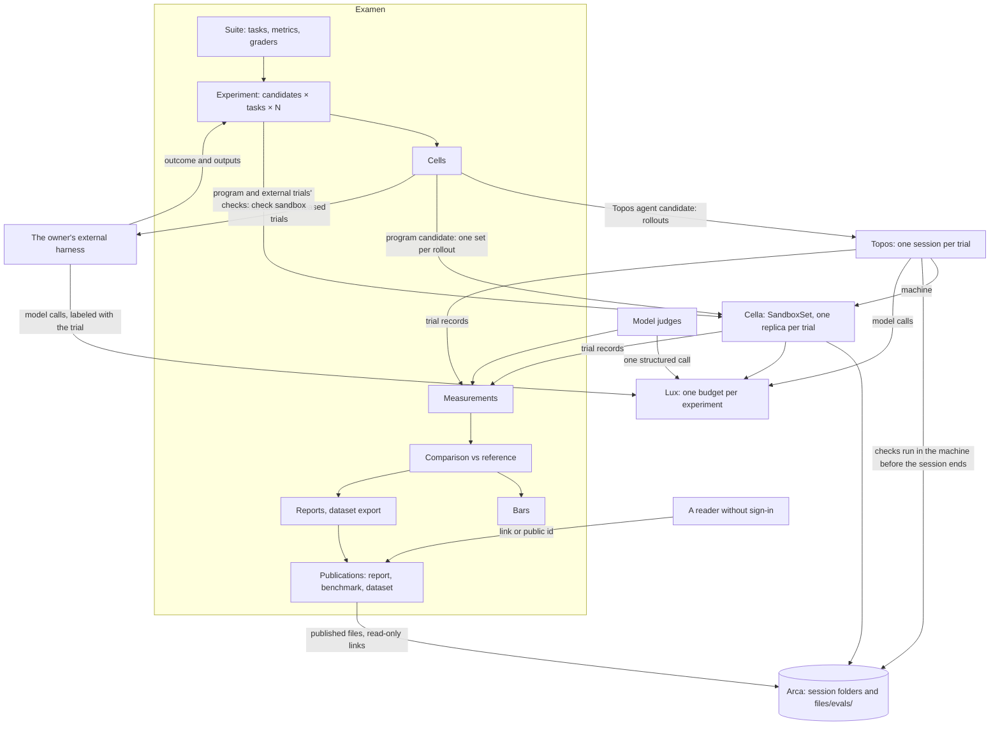

# Architecture

## Overview

Examen runs experiments on agents and on programs built on models, and
tells you what changed. You define tasks, with the inputs they give and
the outputs expected, the metrics that matter, and the graders that
measure them. You name the systems under test to compare and how many
trials each gets: a Topos agent configuration, a program in an image
(an agent command-line tool of any vendor, or Examen's HTTP runner
calling an API such as Lectio's), or a configuration of your own
external harness. Examen asks the cores that already run agents and sandboxes to
execute the trials, or hands them to your external harness, records every
measurement with everything that conditioned it, and compares each
candidate with a reference, a pinned baseline or another candidate of
the same experiment: per metric, improved, regressed, or within noise,
with the confounds named. What it measured can be shared: a report, a
suite others can read with the results its owner ran on it, or a
dataset, each published as immutable versions.

Examen is one of a family of open cores, and it is thin on purpose. It
owns the definitions, the measurements and the analysis, and nothing
else:

- [Topos](https://github.com/latere-ai/topos) runs agents. A trial of a
  Topos agent is a Topos session, and a cell's trials execute as Topos
  rollouts.
- [Cella](https://github.com/latere-ai/cella) runs sandboxes. A trial of
  a program packaged as an image is one replica of a Cella SandboxSet;
  an agent trial's checks run in its Cella machine, and a program's or
  an external trial's in a fresh Cella sandbox, the check sandbox, each
  with network `none`.
- [Lux](https://github.com/latere-ai/lux) carries every model call. An
  experiment's spend is one Lux Budget, its cost comes from Lux's
  records, and a model judge is one call through Lux on a Key from
  Examen's key source.
- [Arca](https://github.com/latere-ai/arca) keeps the evidence: a Topos
  trial's in its session's own folder, and everything Examen writes in
  the owner's reserved folder `files/evals/`, exported datasets and
  published versions included, which readers reach through Arca's
  read-only links. [Origo](https://github.com/latere-ai/origo) holds the
  repositories a task starts from and may take inputs from.
- Your own external harness may run the trials of an `external` candidate
  wherever it likes: it leases them from Examen and submits each
  trial's outcome and outputs, which Examen grades like any trial's.
- An authorizer you write decides who may do what, with the contract
  of [`pkg/authz`](https://github.com/latere-ai/pkg).

Examen executes nothing itself: no agent loop, no sandbox, no model
call on a trial's behalf, no task or check code, and no request to a
host a task or a candidate names.

## Problem

Anyone who builds on agents, or on programs and APIs that call models,
asks the same question whenever a model, an agent's instructions, its
tools, its harness or a program's configuration change: did the change
move what the system does on the tasks that matter? Answering it
by hand means scripting runs, pinning versions, retrying failures,
reading transcripts and building tables, and redoing it for the next
change. It goes wrong in ways that corrupt conclusions silently: two
results that differ in more than the one thing compared, a judge whose
model changed between two gradings, a difference inside the run-to-run
spread reported as a finding, twenty metrics compared at once and the
one that moved by chance reported as the result.

## Concepts

Spec 002 defines every object and its fields. In one paragraph: a
**task** is a versioned unit of work with its inputs, its reference
outputs and its **checks**. A **suite** groups tasks with the
**metrics** they are measured on and the **graders** that produce them.
A **candidate** is one fully pinned system under test: an agent, a
program, or an external harness's configuration. An **experiment** runs
a suite against candidates; each task × candidate pair is a **cell**,
the unit of comparison, and its **trials** are one attempt each. A
cell's trials execute as **rollouts**: a smoke rollout, the main
rollout, and retry rollouts. A grader turns a trial into
**measurements**; a metric's **level** says whether its value belongs
to a trial, to a cell, computed by Examen from the cell's trial values,
or to a candidate, from a judge over all its trials, and a `label`
metric of **open vocabulary** reads its judges' raw labels through a
versioned **taxonomy** of the suite. An experiment's **reference** is a **baseline**, which
pins an earlier experiment's measurements, or one of its own candidates,
the first by default; a **comparison** classifies each metric's change
of a candidate against it; a **bar** fails a release when a change
crosses it. A **publication** shares a report, a benchmark or a dataset
as immutable versions, at a visibility: only people invited, anyone
with the link, or listed.

## How an experiment executes

1. **Apply.** A suite and an experiment are applied. Examen validates
   every pinned reference, asks the authorizer whether the owner may
   run it, and expands the cells.
2. **Budget.** The experiment names one Lux Budget, or gives a spending cap for
   one made for it by the authorizer or, on its own, by Examen as the
   owner. Every model call its
   trials and judges make is metered against it, through Keys that
   Examen's key source leases or that Topos issues its sessions; an
   external harness calls models on Keys its owner gave it, which draw
   on the Budget when the owner makes them. Examen keeps no spend ledger
   of its own.
3. **Smoke.** Each cell first runs `SMOKE_TRIALS` trials as its smoke
   rollout. A cell whose smoke trial fails for a reason other than the
   agent's own behavior parks as blocked. The smoke cost estimates the
   cell's full cost; if the estimate for the remaining trials exceeds
   the smallest remainder the key source reports, the cell parks and
   says so.
4. **Rollouts.** For each cell past its cost check, Examen submits the
   main rollout to the executor for the candidate's kind: the remaining
   trials, a parallelism bound, the task, its checks, the budget, and,
   for a `cella` or `external` rollout, where evidence goes. Before a
   task's first rollout, its inputs and references are copied once into
   the experiment's folder in Arca. A task's cells are dealt
   trials round robin, so candidates compared within one experiment run
   in one time window; under `interleaved` scheduling every cell of
   every task is dealt in turn, so two tasks compared run in one window
   too (spec 005). Trials that failed for an infrastructure reason
   run again in retry rollouts.
5. **Trials.** Topos runs each agent trial to its end, runs the task's
   checks inside the trial's Cella machine once the agent's processes
   have stopped, keeps the evidence in Arca, and reports the trial:
   outcome, the measurements the checks produced, what was sent and
   what served, where the evidence is, cost. Cella runs each program
   trial to its end and keeps its evidence; its checks then run in a
   check sandbox, apart from the program. An external harness runs its
   leased trials and submits each one's outcome and outputs; its checks
   run in a check sandbox, and its cost is read from Lux by the trial's
   request ids or label.
6. **Judges.** Graders that need judgment run over the stored evidence
   after the trial: a model judge as one structured call through Lux,
   an agent judge as a session of a pinned Topos agent, and the decline
   judge that decides whether the agent declined. Each appends
   measurements.
7. **Analysis.** Measurements aggregate per cell. Each candidate is
   compared with the experiment's reference progressively as trials
   finish, and finally at completion; bars are evaluated on final
   comparisons, and reports render.

Infrastructure failures retry up to `MAX_INFRA_RETRIES` with lineage
recorded. Nothing else is retried automatically: an agent that
declines, gives up or times out produced a result, and a trial stopped
because a Budget ran out is excluded and parks its cell until someone
refills the Budget and retries the cell.

## Executors

Examen reaches execution only through an executor, so the core holds no
runtime of its own. An executor accepts a rollout, reports its trials,
and cancels it. Spec 005 fixes the contract.

| Executor | Candidate kind | Executes through | Built today |
|---|---|---|---|
| `topos` | `topos`: a Topos agent version, with a model, reasoning and tools override | Topos rollouts: one session per trial, each in its own Cella machine, the checks run in the machine before the session ends | Topos sessions, budgets and metadata are built; the rollout and the model override are proposed |
| `cella` | `program`: a program packaged as an image, pinned by digest, with its command, environment and configuration: an agent command-line tool of any vendor, the HTTP runner that calls an API, or any other | one Cella SandboxSet per rollout: one replica per trial of the task's environment template, with the program mounted read-only into it from its image, so the environment is identical across candidates; results collected, then each trial's checks run in a check sandbox | designed (Cella spec 020), not built |
| `external` | `external`: a configuration of the owner's own external harness, its name, version and an optional digest, declared and not observed | none of Examen's: the external harness leases pending trials and submits each one's outcome, outputs and the Lux request ids of its model calls; each trial's checks run in a check sandbox, one Cella sandbox from the task's environment template | a single Cella sandbox with its file routes and exec is built; a check with an image also needs Cella's image Volumes (Cella spec 019) |

## Place in the platform

Examen is meant to be the one place evaluation happens. Every existing
piece of evaluation work either becomes Examen's or stays where it is,
on purpose:

| Existing work | After Examen |
|---|---|
| Topos's task suite and release bar (Topos spec 025): tasks with checkers, a pinned model, a threshold of baseline less noise, a Lux budget | Moves onto Examen. Topos's tasks become an Examen suite and its release check calls an Examen bar. Topos keeps no evaluation machinery of its own |
| Topos's review and graded iteration (Topos spec 031): critic and grader threads that send work back until it passes | Stays in Topos. It improves work inside one session; Examen measures finished trials. An agent judge may be built on it |
| Cella's SandboxSet (Cella spec 020), "the unit a rollout or an evaluation asks for" | Stays in Cella. Examen's `cella` executor is its caller |
| Lux Budgets and usage records | Stay in Lux. Examen names a budget, takes Keys from its key source, and reads cost |
| Agon's adversarial review | Stays a library. An agent judge may use it |
| Instruction tests: measuring a change to an agent's instructions | Become Examen experiments whose variable is the agent version |
| Evaluating an API built on models, such as Lectio's, with a client written for the occasion | Becomes an Examen experiment whose candidates are the HTTP runner with each configuration, scored against expected outputs by the built-in comparators |
| A team's own evaluation harness, scoring its own runs | Can stay where it runs: as an `external` candidate it leases Examen's trials and submits outputs that Examen grades, with its provenance marked declared |
| The model router's evaluation set, a training loop's evaluation gate | Become Examen suites and bars; a training loop reads Examen's dataset export |
| Live monitoring and oversight of automated actions | Not Examen. Examen is offline: it measures trials and imported samples |

## Decisions

Each decision names the alternative it rejects.

1. **Examen executes nothing.** Rollouts are a primitive of Topos and
   Cella, and an external harness runs its own. *Rejected:* Examen
   starting and tracking sessions itself, which builds a second rollout
   mechanism beside the SandboxSet Cella designs for this, and drifts
   from both.
2. **An agent's checks run in its machine; a program's and an external
   external harness's run apart.** A `topos` trial's checks run inside its Cella
   machine before it ends, after every process of the turn has stopped,
   with network `none`. A `cella` or `external` trial's checks run in a
   fresh Cella sandbox from the task's environment template, the check
   sandbox, with network `none` and the trial's outputs delivered: a
   program shares no machine with the checks that grade it or the
   references they read, and an external trial's work was not done in
   a machine of Examen's. *Rejected:* checks in a program's replica,
   where a process the program left could read the references or
   change a result; copying an agent trial's artifacts out and grading
   elsewhere, which loses the environment its work was done in; and a
   sandbox of Examen's own.
3. **Two judge kinds, the model judge by default.** A model judge is one
   structured call through Lux with a pinned model, prompt and rubric:
   cheap and reproducible. An agent judge is a session of a pinned
   Topos agent, for a judgment that needs tools to inspect the work.
   *Rejected:* agent judges only, which costs more and varies more for
   judgments a single call makes.
4. **A candidate overrides model and reasoning on a pinned agent
   version.** The override is part of the provenance tuple and the
   agent's digest stays the same, so comparing two models on one agent
   is a single-variable comparison. *Rejected:* deriving a Topos agent
   version per model, which changes the digest and confounds every model
   comparison. The Topos rollout must accept the override.
5. **One Lux Budget per experiment, and Keys from a key source.** Every
   model call is metered against the experiment's Budget. The Keys
   Examen's own calls need come from a key source: the `lux` source,
   after v0.1, creates them at Lux as the owner when Examen runs on its
   own, with the Budget of an experiment that gave a spending cap in place of a
   name, and the `endpoint` source asks an installation that keeps its own
   budgets, which then writes every Key and Budget itself and reports
   the smallest remainder the cost check reads. *Rejected:* a spend
   ledger in Examen, which duplicates Lux's and disagrees with it; and
   Examen writing Keys in an installation that keeps its own budgets,
   which would let an experiment bypass a cap a budget owner set there.
6. **A Topos trial's evidence stays in its session's own folder, and
   Examen's own records go to the owner's reserved folder
   `files/evals/`.** The Topos rollout reports each object's path and
   digest, and Examen references them where they are. The experiment
   and cell manifests, the copies of each task's inputs and references,
   judge rationale, a `cella` trial's evidence, an external trial's
   outputs and check outputs, dataset exports and report bundles live
   under `files/evals/`.
   Examen keeps references and digests. The one copy is a published
   version's: the evidence its owner publishes is copied into the
   version's folder under `files/evals/publications/`, so a snapshot
   stands when its source is deleted and one Arca link covers exactly
   what was published (spec 013). *Rejected:* Examen copying evidence
   out of a session's folder for its own records, which makes two
   copies to keep consistent and two places to delete.
7. **Statistics are part of the contract, not a report option.** N is
   declared before a cell runs. No task-level verdict before
   `MIN_TRIALS_FOR_VERDICT` finished trials, and no suite-level verdict
   below `MIN_SUITE_COVERAGE`. Noise comes from within-cell spread.
   Binary task-level results use Boschloo's exact unconditional test on
   a fixed grid; numeric ones a permutation test of their declared
   aggregate's studentized statistic, Welch's for a mean and Chung and
   Romano's for a quantile, so unequal trial counts and spreads keep
   the level; a label's repeat rate a permutation of its difference;
   label distributions Fisher, Freeman and Halton's exact test, or a
   permutation of the chi-square statistic with a fixed seed when its
   tables are too many to enumerate. Intervals are Wilson and Newcombe
   for rates, Wilson on Kish's effective sample size and Agresti and
   Caffo's for suite-level rates, bootstrap-t for means and exact
   order-statistic intervals for quantiles. Each comparison's p-values
   form two parts: the primary metric's suite-level result, one
   pre-declared test reported without correction when the comparison
   was declared before the experiment ran, and one family of every
   other result, corrected by Benjamini and Hochberg's procedure at
   `FALSE_DISCOVERY_RATE`; a comparison made later is exploratory, its
   primary result is in the family, and it is never headlined.
   *Rejected:* raw deltas with a fixed threshold, which over-report;
   and correcting the primary result with every task-level result,
   which makes the result a release rests on depend on how many tasks
   and metrics a suite lists.
8. **Confounds are computed, never asserted.** Every tuple field that
   differs besides the declared variable is a confound, and only
   single-variable comparisons are headlined; what was sent and what
   served are confounds of the tasks they affect, and missing values,
   excluded trials and time windows far apart of the results they
   touch. *Rejected:* trusting the label a person gives a comparison.
9. **Judges are pinned and grades are generations.** Changing a judge's
   model, prompt or rubric makes a new grader version; re-grading
   appends a generation and never overwrites. Human annotations are
   generations too, and calibrate judges. *Rejected:* overwriting
   grades, which makes judge drift look like agent change.
10. **Trials Examen did not start can be graded.** A finished Topos
    session or Cella sandbox is imported as a trial with its provenance
    read from its records, so the same graders score production
    samples, and an external harness's past trial is imported with its
    times, `harness_version` and image declared, so a study run before
    Examen is backfilled and marked declared. The import of past trials
    ships in the first release; imported sessions and sandboxes are
    built after the executed path. *Rejected:* executed trials
    only, which leaves the graders unusable on real traffic.
11. **Public benchmarks are imported as ordinary tasks.** A manifest
    format, no built-in benchmark adapters. *Rejected:* shipping
    benchmark content, which is not Examen's to own.
12. **Dataset export, after the console path,** into Arca. Trials with
    their measurements and evidence references export as records a
    training loop reads. *Rejected:* reports only, which leaves a
    training loop to re-derive what Examen already holds.
13. **Bars, after the console path; Topos's release bar becomes a suite
    then.** *Rejected:* reporting without bars, which keeps two
    evaluation mechanisms.
14. **Offline only.** Examen measures trials and imported samples; live
    monitoring stays with the observability and oversight systems.
15. **A task starts from a pinned Origo commit or a pinned Arca path,**
    and takes its inputs and references from the same or from inline
    text. *Rejected:* arbitrary URLs, which cannot be pinned or
    authorized, and which examend would have to fetch.
16. **The first consumer is people comparing agents in a console, and
    the console follows the v0.1 API.** The first release serves the
    v0.1 profile: suites, `external` candidates and experiments in modes
    `execute` and `import`, the lease and submit of external trials, the
    import of an external harness's past trials, the values an external
    harness reports for itself, kept self-reported, and the read API a
    console renders from without computing any statistic itself, the
    paged grid, comparisons with their rows and the progress stream. It
    needs no owner token source, key source or file store (spec 003).
    A console's section follows once its prototype is reviewed, then
    the `topos` executor once Topos's rollout exists, then checks and
    judges with the key source and the minter, then the built-in
    comparators, label tests with open vocabularies and the cell and
    candidate levels, bars, dataset export, publishing, agent judges,
    annotations, imported trials, the `cella` executor with the
    `program` kind and the HTTP runner once Cella's SandboxSet exists,
    adoption, the gap map, trends and report exports
    (specs/README.md). *Rejected:* a training loop or the release bar
    first, which exercises the same core but leaves people without a
    way to compare agents; and the `topos` executor first, which waits
    on a Topos rollout that does not exist yet, while comparing the
    external harnesses people already run needs nothing but Examen.
17. **Three kinds of system under test.** A candidate is a Topos agent,
    a program in an image, or an external harness's configuration. An
    agent command-line tool of any vendor is one kind of program, not
    the definition of one. *Rejected:* agents only, which leaves
    programs and APIs built on models unmeasured; and a kind per vendor
    tool, which grows with every vendor.
18. **APIs are evaluated through programs.** An API is called by a
    program in a trial's sandbox, under its network policy: Examen's
    HTTP runner, driven by the candidate's configuration, with owner
    tokens for the APIs it calls placed as Cella Secrets, never for a
    service Examen acts through. *Rejected:* a
    direct HTTP executor in examend, which would make examend an
    outbound client of arbitrary hosts and an SSRF surface; and asking
    every user to write a client.
19. **References are hidden from the system under test.** A task's
    expected outputs reach only its checks: after the system under
    test's processes have stopped, or in a check sandbox it never ran
    in. *Rejected:* delivering references with the inputs, which lets a
    system under test copy the answer.
20. **Comparators are checks.** Reference-based scoring runs as ordinary
    check graders over Examen's first-party comparator image, so it
    needs no model judge and produces the owner's declared metrics.
    *Rejected:* a model judge for exact or field-level comparison, which
    costs a call and adds variance where a program decides; and
    comparison code in examend, which would run check code there.
21. **An external harness runs its own trials, and its provenance is
    declared.** It leases trials and submits outcomes and outputs, which
    the task's checks grade in a check sandbox; it declares its model,
    reasoning and settings explicitly, so its configurations are
    compared one field at a time; its cost is read from Lux by request
    id or label, and is unknown, never zero, when Lux holds no record of
    it. Values it computes itself are kept as self-reported, never
    headlined, and named as a confound wherever they are read.
    *Rejected:* trusting self-reported scores, which lets an external harness
    grade itself; and requiring every external harness to be packaged as an
    image, which shuts out external harnesses that cannot be.
22. **Results are shared as published snapshots, and sharing has one
    definition.** Only people invited is a share grant of one owner to
    another; anyone with the link and listed reach a publication, a
    report, a benchmark or a dataset published as immutable versions
    with a digest, at the evidence level its owner chose, after a
    secret scan in a Cella sandbox of its snapshot and any trial
    content, with evidence served for download only through Arca
    read-only links Examen creates and revokes.
    `public` comes only through a listing the installation approves:
    Examen asks the authorizer `publication.list` and keeps no review
    of its own. A reader who does not sign in reads published versions
    only, and the authorizer is still asked, with no subject. A
    benchmark is open, not held out: whoever runs it reads its
    references and checks. It orders its ranked entries by their point
    estimates over the tasks all of them cover and shows each a rank
    interval that holds across the whole table, from task-stratified
    tests over the entries' own trial values adjusted for every pair,
    and its comparison with a reference entry, adjusted with them; the
    order is never shown as a rank by itself (specs 008 and 013). *Rejected:* anonymous
    reads of live objects, which change under a reader and expose what
    was never chosen for publication; a review flow in the core, which
    would duplicate the installation's; file links minted by Examen,
    which would make it a second file server beside Arca; a bare
    ranking, which reads differences the data cannot show; and groups
    of entries whose intervals overlap, which is not a test, does not
    chain, ignores the pairing by task and ignores how many pairs a
    table compares.
23. **A metric has a level, and a label may have an open vocabulary.**
    A metric belongs to a trial, to a cell, as a statistic Examen
    computes from the cell's trial values (the tested `repeat_rate`,
    and `mode_share` and `distinct_count`, which depend on the number
    of trials and are descriptive), or to a candidate, from a judge
    over all its trials, with generations. A label metric may leave its
    labels open: a judge proposes a raw label per trial, and the
    suite's taxonomy, versioned and changed by the owner or a pinned
    canonicalizer, maps it to a canonical label, a label not yet mapped
    counting as its own; results name the taxonomy version they read,
    and a change appends a version, never rewriting a measurement
    (specs 006 and 008). *Rejected:* forcing every label
    into a closed list before a study runs, which loses what nobody
    expected; and rewriting stored labels when a taxonomy changes,
    which makes a past comparison irreproducible.
24. **People create; the owner's side runs; everyone else who can see
    an experiment reads it.** An experiment, and every object an owner
    applies, is created by a person under an owner, the person or an
    organization they belong to, so its `owner` and its `created_by`
    can differ and both are kept. Only its creator, its owner and the
    owner's members run it: every action that starts, feeds or changes
    its execution, and it runs on a suite of its owner's. Every share,
    of an experiment, a publication, a suite or a baseline, a link and
    a listing let everyone else read; a
    published benchmark runs on its owner's side alone and takes
    submissions from it alone, with `submissions` kept so that can be
    reopened. A published version names the person who signed off on
    publishing it, `published_by`, a subject the installation names on
    its pages after reading it signed in: no public read carries a
    subject.
    Examen reads no claim, so telling a person from a service and an
    organization's member from a stranger is the authorizer's (spec
    004). *Rejected:* a member role of an experiment beside its
    owner's, which would be a second membership the installation
    already keeps; shares that run, which would let a reader spend the
    owner's budget or feed its results; a suite share that lets its
    grantee run experiments of its own on the suite, which makes a share
    more than a grant of reading; and a name for the publisher
    stored in Examen, which holds no profile and would keep a name the
    person changed.

## Service shape

One binary, `examend`: an HTTP API under a configurable base path,
Postgres for every object and the work queue, the executors in process,
telemetry through `pkg/otel`. Evidence stays in Arca. A command-line
client and any console use the same API. Spec 011 covers distribution.

## Spec index

| Spec | Fixes |
|---|---|
| 002 Objects | every object, its fields, states, identifiers and limits |
| 003 API | the contract a client codes against, its errors, and the event sink |
| 004 Identity and authorization | the authorizer contract, actions, the built-in owner policy, share grants of reading alone and readers who do not sign in, acting as the owner, the key source |
| 005 Execution | the executor contract, the `topos`, `cella` and `external` executors, task inputs and references, the HTTP runner, the check sandbox, smoke and the cost check, task-by-task and interleaved scheduling and the lease order, retries and retrying a parked cell, cancellation, imported trials and external past trials, an API's own cost |
| 006 Grading | checks, the built-in comparators, model judges and the directory outputs they read, candidate-level judges, agent judges, annotations, the decline judge, generations, open vocabularies and their taxonomies, calibration |
| 007 Measurements and evidence | the measurement store, provenance layers, evidence references and where evidence lives, retention, dataset export |
| 008 Analysis | aggregation and intervals by metric level, studentized permutation tests and the label tests, the stratified label test, the repeat rate, score intervals for weighted rates, the primary result, exploratory comparisons and the corrected family, declared comparisons corrected together and the experiment's test of independence, confounds, automatic comparisons, verdicts, reasons and the power floor, a benchmark's rank intervals, trends |
| 009 Bars | bar rules, evaluation, release use, bar events |
| 010 Reports | what a console reads and shows, the report document, export |
| 011 Distribution | the binary, configuration, Postgres, upgrades, versioning |
| 012 Security | untrusted task content, judges reading hostile output, references hidden from the system under test, credentials given to programs, external harnesses, cost exhaustion, evidence privacy, published evidence and readers without sign-in |
| 013 Publishing | the one definition of sharing; reports, benchmarks and datasets as published snapshots, evidence levels and the secret scan, Arca links, reads without sign-in, benchmark submissions and results, withdrawal, pause, attribution |

## Acceptance criteria

- No code path in Examen starts a model call, a sandbox or an agent
  loop for a trial; every trial is executed through an executor, and
  examend sends no request to a host a task or a candidate names.
- A check's measurements arrive from the executor; Examen never executes
  task or check code.
- An experiment without a budget, or whose smallest remainder cannot
  cover a cell's estimate after its smoke trial, starts no trial in
  that cell past the smoke.
- With the `endpoint` key source, Examen creates no Key or Budget at
  Lux.
- With no owner token source, key source or file store, an experiment
  of `external` candidates runs to its final comparisons with no
  request to any core.
- Comparing two models on one agent version yields a single-variable
  comparison.
- An experiment with no baseline compares every candidate with its
  first, and shows verdicts while it runs.
- With `MIN_TRIALS_FOR_VERDICT - 1` finished trials in a cell, every
  task-level verdict for that cell is `insufficient`.
- A comparison of many metrics and tasks reports its primary metric's
  suite-level result uncorrected and every other verdict after one
  correction at `FALSE_DISCOVERY_RATE`, and the uncorrected values are
  readable beside them.
- Re-grading with a changed judge appends a generation; earlier ones
  are unchanged.
- No sandbox holds a task's references while its system under test can
  run, no program's sandbox ever holds one, and no lease answer carries
  one.
- A value an external harness reports for itself is never headlined,
  and every result that reads it names `self_reported`; a comparison
  with an external side marks its provenance declared.
- Two configurations of one program compared in one experiment yield a
  single-variable comparison.
- A published version never changes, and no request makes a
  publication `public` without the authorizer allowing
  `publication.list`; a withdrawn version's links stop resolving and
  its Arca links are revoked.
- A taxonomy change appends a version and leaves every measurement and
  every final comparison as it was.

## Open questions

None in the core. Which judge models an owner trusts with their data is
the owner's choice, and the hosting installation states each model's
data terms and may narrow the choice through `judge_models` (spec 004).

## Outcome

In progress. v0.1.0 builds the thin core for the v0.1 profile: the
versioned objects, experiments of `external` candidates run through
leases and submits or imported from past runs, the append-only
measurement store, and the analysis that decides every comparison.
`external` is the only executor: `topos` and `program` candidates are
stored and refused at create, and examend holds no client of Topos,
Cella, Lux, Arca or Origo, so no check, judge, sandbox, key source or
owner token exists yet. v0.2.0 records an experiment's creator beside
its owner, v0.3.0 adds declared comparisons and interleaved
scheduling, and v0.4.0 passes a create's `sign_in` to the authorizer.

Every row below shipped in v0.1.0.

| # | Verdict | Held by |
|---|---|---|
| 1 | Partly met: examend's only outbound clients fetch the issuers' keys and ask the authorizer, no file starts a process, and `external` is the only executor; no test asserts any of the three | no test yet |
| 3 | Partly met: a create without a budget is refused `400 missing_field`, so no trial starts; the check of a Budget's remainder against a cell's estimate is not built | `httpapi.TestCreateRefusals` |
| 5 | Partly met: an `execute` experiment runs through leases and submits to completion, and an `import` experiment to computed final comparisons, with no core configured; no test records the absence of requests to a core, and the hermetic `execute` runs compute no figures | `httpapi.TestRetriesBlockAndResume`, `httpapi.TestAnalyzedImport`, `httpapi.TestComparisons` |
| 6 | Partly met: the analysis names `model` the single variable of two tuples on one agent version; no experiment holds agent candidates until the `topos` executor exists | `analysis.TestModelComparisonIsSingleVariable`, `objects.TestTuples` |
| 7 | Met | `httpapi.TestAnalyzedImport`, `httpapi.TestComparisons` |
| 8 | Met | `analysis.TestInsufficientBelowMinimum`, `httpapi.TestAnalyzedImport` |
| 9 | Met | `analysis.TestPrimaryStandsAlone`, `analysis.TestBenjaminiHochberg`, `httpapi.TestAnalyzedImport` |
| 11 | Partly met: no sandbox exists, and a lease answer has no member that could carry a reference; no test leases a task with references and reads the answer | no test yet |
| 12 | Met; a report's headline waits on spec 010 | `analysis.TestSelfReported`, `analysis.TestDeclaredProvenance`, `httpapi.TestAnalyzedImport` |
| 13 | Partly met: the analysis treats a program's `config` as one logical variable; `program` candidates are refused at create until the `cella` executor exists | `analysis.TestProgramConfigIsSingleVariable`, `objects.TestTuples` |
| 15 | Partly met: a taxonomy change appends the next record naming the one before it; that measurements and final comparisons stay as they were is untested | `httpapi.TestTaxonomies`, `analysis.TestTaxonomyReads` |

Not built: 2, checks; 4, the `endpoint` key source; 10, judges and
re-grading; 14, publishing.
