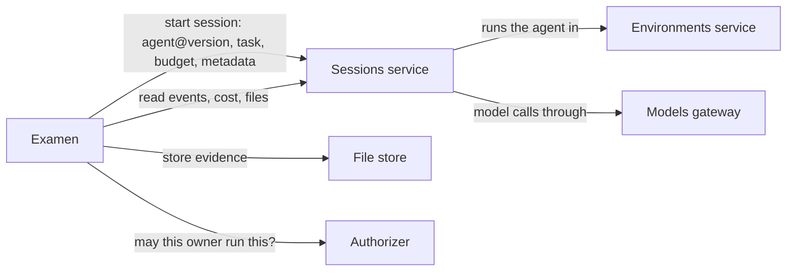

# Architecture

## Overview

Examen runs experiments on agents. A person describes a task once, names
the agents, models and environments to try it with, and says how many
times each combination runs. Examen starts every run through the
services that already run agents, sandboxes and model calls, grades
what each run produced, and reports outcomes that can be compared,
with the noise and the confounds stated next to every number.

A run here is one agent session working one task to its end. A
**rollout** is the set of N runs of one combination: N samples of how
that agent, on that model, in that environment, behaves on that task.
Rollouts are the unit an experiment measures, and they are also what a
training loop consumes: each run with its grades is one scored
trajectory.

Examen does not run agents, sandboxes or models itself. It owns the
experiment: what is run, how often, under which budget, how each run is
graded, and what the results say. Everything that executes is another
service's.

## Problem

Anyone who builds on agents asks the same question whenever a model, an
agent's instructions or its tools change: given this task, did the
change move what the agent does? Answering it by hand means scripting
runs, pinning versions, retrying failures, reading transcripts and
building comparison tables, and doing it again for the next change. The
work is mechanical, and it goes wrong in ways that corrupt a conclusion
without anyone noticing: two runs that differ in more than the one thing
being compared, a judge model that changed between two gradings, a
difference smaller than the run-to-run spread reported as a result.

## What it is not

- **Not a benchmark dataset.** Tasks are the owner's content. Examen
  contributes the machinery, not the questions.
- **Not a leaderboard.** It produces evidence and comparisons for the
  people who ran them; publishing a report is a deliberate export.
- **Not an agent runtime, a sandbox or a model gateway.** It calls
  those through their APIs and keeps no copy of their state beyond the
  references and figures it needs to measure.
- **Not an automatic scientist.** Tables, deltas and noise floors are
  computed. A written interpretation is drafted by a pinned model,
  checked against the confounds, and released only by a person.

## Objects

```
Suite ── owns the budget, the evidence folder, baselines and gates
  └─ Task ── a content-hashed instruction, a starting workspace, graders, N
       └─ Cell ── Task × one provenance tuple  (the unit of comparison)
            └─ Run ── one session to its end   (the unit of evidence)
                 └─ Grade ── one grader's verdict on a run (append-only)
Comparison ── a declared set of cells, its confounds computed
```

A rollout is a cell's runs. Spec 002 fixes each object's fields, states
and identifiers.

### The provenance tuple

A cell's identity is everything that conditions its runs, because an
agent's behavior depends on all of it:

```
(agent, agent_version_digest, model, model_route, effort,
 environment_template, environment_digest, task_hash, seed_ref, n)
```

Every field is pinned. A floating reference, a `latest` tag, an agent
named without a version, a model alias with nothing recording what
served it, is refused when the suite is applied. Two cells are
comparable exactly through this tuple.

### Configured, sent, observed

What a person asked for, what was sent, and what happened are three
different facts, and a report never merges them:

| Layer | Fields | Source |
|---|---|---|
| configured | model, effort, agent version | the cell |
| sent | the model and reasoning settings on each request | the session's request events |
| observed | the model that served, token usage including reasoning, cost | the session's request events and the gateway's usage records |

## Principles

These carry over from an earlier admin-only design of the same
instrument, whose engine was never built. They are decided here, not
open:

1. **Confounds are computed, never asserted.** A comparison names the
   one field it intends to vary. Examen computes every other tuple
   field that also differs; the comparison is single-variable only when
   that set is empty. A report may headline only single-variable
   comparisons, and names the confounds of every other finding inline.
2. **Judges are pinned; grades are generations.** A model-based grader
   is a (model, prompt hash) pair recorded in every grade. Changing
   either makes a new judge. Re-grading appends a generation and never
   overwrites one.
3. **Cost comes from the records of the service that metered it,**
   joined by request or session, never re-estimated from token counts.
4. **Budget is part of the schema.** Every suite has a cap. A run that
   would exceed it is not started; the cell parks and says why.
5. **A smoke run comes before spending.** Each cell runs one trivial
   probe before its N runs. A failing probe parks the cell as blocked
   instead of buying N corrupt results.
6. **An agent declining a task is data.** Only infrastructure failures
   are retried and excluded; a refusal or an abandoned plan is a result
   about the agent, classified by a grader, not by retry logic.
7. **Every delta has a noise floor.** The run-to-run spread within a
   cell is measured, and differences are tested with exact small-sample
   methods. A difference within the noise is reported as noise.
8. **Evidence is kept.** Transcripts, workspace trees and request
   records are retained by default; analyses keep needing facts nobody
   planned to extract.
9. **Completed evidence is never re-bought or re-used silently.**
   Resuming skips completed runs. Adopting another suite's cells is
   explicit, age-checked, and marked in the report.
10. **Judges are calibrated against people.** A person's annotation is
    a grade generation like any other; agreement per judge decides
    whether its figures are flagged as uncalibrated.

## How a run executes



1. A suite is applied. Examen validates every tuple, asks the
   authorizer whether the owner may run it, and expands the cells.
2. For each cell, Examen starts the smoke run, then the N runs, each as
   one unattended session of the named agent version, with the task's
   instruction as its first message, a budget no larger than the cell's
   share of the suite's remainder, and metadata that names the suite,
   cell and run index.
3. The sessions service runs the agent in the named environment and
   meters its model calls. Examen follows each session to its end.
4. When a session ends, Examen reads its events (requests, usage, cost,
   tool calls), copies the transcript and the files the task names into
   the evidence folder, and records the run.
5. Graders run on the run's evidence. Deterministic graders are pure
   functions over the workspace and the transcript; model-based graders
   are sessions of a pinned judge agent and are budgeted like any run.
6. Comparisons, noise floors and gates are recomputed from the grades.
   A gate that a run crosses raises an alert.

Parallelism is bounded per suite. Infrastructure failures are retried
up to a limit with lineage recorded; nothing else is retried.

## Interfaces this depends on

Examen is useful only through the services it calls. These are the
interfaces the design assumes, and whether they exist today:

| Interface | Used for | Today |
|---|---|---|
| Sessions: start a session of a named agent version with a message, budget, limits, metadata and `attended: false`; read its events and stream; end it | every run and every model-based grade | Built. There is no batch call, so Examen starts sessions one by one, tags each with metadata (at most 32 strings), and finds them by metadata filter |
| Sessions: per-request events carrying the model served, usage and cost; the session's spent budget | the sent and observed layers, cost | Built |
| Sessions: files of the session's workspace | evidence | Built while the session's machine runs, so Examen copies files before the session is ended |
| Environments: a set of N replicas of one template with per-replica variants and collected results | running a rollout as one object rather than N sessions | Designed, not built. v1 fans out sessions and does not need it |
| Models gateway: usage and request records by request | cost from the metering service's own records | Built. Only key labels aggregate; per-request labels are recorded but not summed, so v1 reads cost from session events |
| File store: write files under the owner's tree with a scoped token | the evidence folder | Built |
| Authorizer: an endpoint you write that answers whether a subject may act on a resource | who may run, read and export what | The same contract the other open cores use |

## Access and ownership

A suite belongs to an owner: a person or an organization. Every action,
applying a suite, starting runs, reading results, exporting a report,
is asked of the authorizer with the owner, the subject and the
resource. Examen fails closed when the authorizer does not answer.
Without an authorizer, a built-in policy lets an owner act on their own
suites and nothing else.

Runs execute with the owner's identity and budget, never Examen's own:
the sessions it starts, the model calls they make and the evidence they
write are attributed to the owner.

## Service shape

One binary, `examend`, with Postgres for suites, cells, runs, grades
and comparisons, and an HTTP API under a configurable base path. Its
work queue lives in the same database. Evidence lives in the file
store, not in Postgres. A command-line client and any console reach the
same API.

## Acceptance criteria

- Applying a suite with a floating reference in any tuple field is
  refused, naming the field.
- A comparison whose cells differ in more than its declared variable
  reports those fields as confounds, and a report headlines only
  single-variable comparisons.
- A suite at its budget cap starts no further run; the waiting cells
  park with the reason.
- A cell whose smoke run fails starts none of its N runs.
- Re-grading a run with a changed judge appends a generation; earlier
  grades are unchanged and still readable.
- A run's cost equals the sum of the cost the sessions service recorded
  for its requests.
- An action the authorizer denies is refused, and an authorizer that
  does not answer refuses every action.
- Every run, grade and file Examen writes is attributed to the suite's
  owner.

## Open questions

- **Judge models.** One strong, inexpensive default per judge, or a
  choice per suite, and how a judge's spend is capped against the runs'.
- **Sharing reports.** Whether a report can be shared beyond the owner
  by link, or leaves only by export.
- **Starting workspaces.** Tasks that begin from a non-empty repository
  are in the tuple (`seed_ref`) but no first use has shaped the
  contract.
- **The first consumer.** Whether the first use is people comparing
  agents from a console, or a training loop that consumes rollouts and
  their grades as rewards. The two order the build differently.
