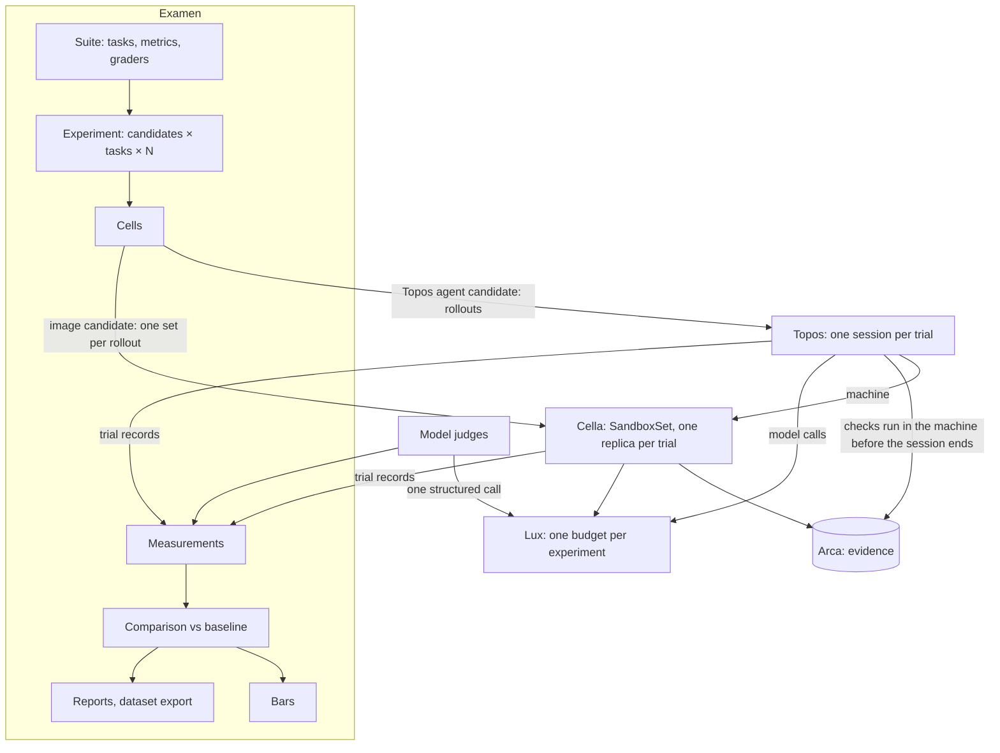

# Architecture

## Overview

Examen runs experiments on agents and tells you what changed. You
define tasks, the metrics that matter, and the graders that measure
them. You name the agent configurations to compare and how many trials
each gets. Examen asks the cores that already run agents and sandboxes
to execute the trials, records every measurement with everything that
conditioned it, and compares the results with a baseline: per metric,
improved, regressed, or within noise, with the confounds named.

Examen is one of a family of open cores, and it is thin on purpose. It
owns the definitions, the measurements and the analysis, and nothing
else:

- [Topos](https://github.com/latere-ai/topos) runs agents. A trial of a
  Topos agent is a Topos session, and a cell's trials execute as Topos
  rollouts.
- [Cella](https://github.com/latere-ai/cella) runs sandboxes. A trial of
  an agent packaged as an image is one replica of a Cella SandboxSet,
  and every trial's checks run in its Cella machine.
- [Lux](https://github.com/latere-ai/lux) carries every model call. An
  experiment's spend is one Lux Budget, its cost comes from Lux's
  records, and a model judge is one call through Lux.
- [Arca](https://github.com/latere-ai/arca) keeps the evidence and the
  exported datasets. [Origo](https://github.com/latere-ai/origo) holds
  the repositories a task starts from.
- An authorizer you write decides who may do what, with the contract
  of [`pkg/authz`](https://github.com/latere-ai/pkg).

Examen executes nothing itself: no agent loop, no sandbox, no model
call on a trial's behalf, no task or check code.

## Problem

Anyone who builds on agents asks the same question whenever a model,
an agent's instructions, its tools or its harness change: did the
change move what the agent does on the tasks that matter? Answering it
by hand means scripting runs, pinning versions, retrying failures,
reading transcripts and building tables, and redoing it for the next
change. It goes wrong in ways that corrupt conclusions silently: two
results that differ in more than the one thing compared, a judge whose
model changed between two gradings, a difference inside the run-to-run
spread reported as a finding, twenty metrics compared at once and the
one that moved by chance reported as the result.

## Concepts

Spec 002 defines every object and its fields. In one paragraph: a
**task** is a versioned unit of work with its **checks**. A **suite**
groups tasks with the **metrics** they are measured on and the
**graders** that produce them. A **candidate** is one fully pinned agent
configuration. An **experiment** runs a suite against candidates; each
task × candidate pair is a **cell**, the unit of comparison, and its
**trials** are one agent attempt each. A cell's trials execute as
**rollouts**: a smoke rollout, the main rollout, and retry rollouts. A
grader turns a trial into **measurements**. A
**baseline** pins an experiment's measurements as the reference; a
**comparison** classifies each metric's change against it; a **bar**
fails a release when a change crosses it.

## How an experiment executes

1. **Apply.** A suite and an experiment are applied. Examen validates
   every pinned reference, asks the authorizer whether the owner may
   run it, and expands the cells.
2. **Budget.** The experiment names one Lux Budget. Every model call its
   trials and judges make is metered against it, through keys issued
   under it. Examen keeps no spend ledger of its own.
3. **Smoke.** Each cell first runs `SMOKE_TRIALS` trials as its smoke
   rollout. A cell whose
   smoke trial fails for a reason other than the agent's own behavior
   parks as blocked. The smoke cost estimates the cell's full cost; if
   the estimate for the remaining trials exceeds what the budget has
   left, the cell parks and says so.
4. **Rollouts.** For each cell past its gate, Examen submits the main
   rollout to the executor for the candidate's kind: the remaining
   trials, a parallelism bound, the task, its checks, the budget, and
   where evidence goes. Trials that failed for an infrastructure reason
   run again in retry rollouts.
5. **Trials.** Topos or Cella runs each trial to its end, runs the
   task's checks inside the trial's Cella machine, writes the evidence
   to Arca, and reports the trial: outcome, the measurements the checks
   produced, what was sent and what served, cost.
6. **Judges.** Graders that need judgment run over the stored evidence
   after the trial: a model judge as one structured call through Lux,
   an agent judge as a session of a pinned Topos agent, and the decline
   judge that decides whether the agent declined. Each appends
   measurements.
7. **Analysis.** Measurements aggregate per cell. Comparisons with the
   baseline classify every metric, bars are evaluated, and reports
   render.

Infrastructure failures retry up to `MAX_INFRA_RETRIES` with lineage
recorded. Nothing else is retried: an agent that declines, gives up or
times out produced a result.

## Executors

Examen reaches execution only through an executor, so the core holds no
runtime of its own. An executor accepts a rollout, reports its trials,
and cancels it. Spec 005 fixes the contract.

| Executor | Candidate kind | Executes through | Built today |
|---|---|---|---|
| `topos` | a Topos agent version, with a model and reasoning override | Topos rollouts: one session per trial, each in its own Cella machine, the checks run in the machine before the session ends | Topos sessions, budgets and metadata are built; the rollout and the model override are proposed |
| `cella` | an agent program packaged as an image, any vendor's command-line agent | one Cella SandboxSet per rollout: one replica per trial of the task's environment template, with the candidate's program mounted read-only into it from the candidate's image, so the environment is identical across candidates; the checks as the completion command, results collected | designed (Cella spec 020), not built |

## Place in the platform

Examen is meant to be the one place evaluation happens. Every existing
piece of evaluation work either becomes Examen's or stays where it is,
on purpose:

| Existing work | After Examen |
|---|---|
| Topos's task suite and release bar (Topos spec 025): tasks with checkers, a pinned model, a threshold of baseline less noise, a Lux budget | Moves onto Examen. Topos's tasks become an Examen suite and its release check calls an Examen bar. Topos keeps no evaluation machinery of its own |
| Topos's review and graded iteration (Topos spec 031): critic and grader threads that send work back until it passes | Stays in Topos. It improves work inside one session; Examen measures finished trials. An agent judge may be built on it |
| Cella's SandboxSet (Cella spec 020), "the unit a rollout or an evaluation asks for" | Stays in Cella. Examen's `cella` executor is its caller |
| Lux Budgets and usage records | Stay in Lux. Examen names a budget and reads cost |
| Agon's adversarial review | Stays a library. An agent judge may use it |
| Instruction tests: measuring a change to an agent's instructions | Become Examen experiments whose variable is the agent version |
| The model router's evaluation set, a training loop's evaluation gate | Become Examen suites and bars; a training loop reads Examen's dataset export |
| Live monitoring and oversight of automated actions | Not Examen. Examen is offline: it measures trials and imported samples |

## Decisions

Each decision names the alternative it rejects.

1. **Examen executes nothing.** Rollouts are a primitive of Topos and
   Cella. *Rejected:* Examen starting and tracking sessions itself,
   which builds a second rollout mechanism beside the SandboxSet Cella
   designs for this, and drifts from both.
2. **Checks run inside the trial's Cella machine, before it ends.** The
   executor runs them and returns measurements. *Rejected:* copying
   artifacts out after the trial and grading elsewhere, which needs a
   sandbox of Examen's own and loses the environment the work was done
   in.
3. **Two judge kinds, the model judge by default.** A model judge is one
   structured call through Lux with a pinned model, prompt and rubric:
   cheap and reproducible. An agent judge is a session of a pinned
   Topos agent, for a judgment that needs tools to inspect the work.
   *Rejected:* agent judges only, which costs more and varies more for
   judgments a single call makes.
4. **A candidate overrides model and reasoning on a pinned agent version.**
   The override is part of the provenance tuple and the agent's digest
   stays the same, so comparing two models on one agent is a
   single-variable comparison. *Rejected:* deriving a Topos agent
   version per model, which changes the digest and confounds every
   model comparison. The Topos rollout must accept the override.
5. **One Lux Budget per experiment.** *Rejected:* a spend ledger in
   Examen, which duplicates Lux's and disagrees with it.
6. **Executors write a trial's evidence to Arca, and Examen writes its
   own records there: the experiment and cell manifests and judge
   rationale. Examen keeps references and digests.** *Rejected:*
   Examen copying evidence.
7. **Statistics are part of the contract, not a report option.** N is
   declared before a cell runs. No verdict before
   `MIN_TRIALS_FOR_VERDICT` finished trials. Noise comes from
   within-cell spread. Binary metrics use exact tests, continuous
   metrics permutation or bootstrap intervals, and each comparison is
   corrected for multiple comparisons in two families: the task family,
   every task-level result of the comparison, for every metric of the
   suite, that has a p-value; and the suite family, every suite-level
   result of the comparison that has a p-value. Each family is
   corrected by Benjamini and Hochberg's procedure at
   `FALSE_DISCOVERY_RATE`. *Rejected:* raw deltas with a fixed
   threshold, which over-report.
8. **Confounds are computed, never asserted.** Every tuple field that
   differs besides the declared variable is a confound, and only
   single-variable comparisons are headlined. *Rejected:* trusting the
   label a person gives a comparison.
9. **Judges are pinned and grades are generations.** Changing a judge's
   model, prompt or rubric makes a new grader version; re-grading
   appends a generation and never overwrites. Human annotations are
   generations too, and calibrate judges. *Rejected:* overwriting
   grades, which makes judge drift look like agent change.
10. **Trials Examen did not start can be graded.** A finished Topos
    session or Cella sandbox is imported as a trial with its provenance
    read from its records, so the same graders score production
    samples. Built after the executed path. *Rejected:* executed trials
    only, which leaves the graders unusable on real traffic.
11. **Public benchmarks are imported as ordinary tasks.** A manifest
    format, no built-in benchmark adapters. *Rejected:* shipping
    benchmark content, which is not Examen's to own.
12. **Dataset export, after the console path,** into Arca. Trials with
    their measurements and evidence references export as records a
    training loop reads. *Rejected:* reports only, which leaves a
    training loop to re-derive what Examen already holds.
13. **Bars, after the console path; Topos's release bar becomes a suite
    then.** *Rejected:* reporting without bars, which keeps two
    evaluation mechanisms.
14. **Offline only.** Examen measures trials and imported samples; live
    monitoring stays with the observability and oversight systems.
15. **A task starts from a pinned Origo commit or a pinned Arca path.**
    *Rejected:* arbitrary URLs, which cannot be pinned or authorized.
16. **The first consumer is people comparing agents in a console.** The
    first slice is the path a comparison needs: suites, candidates and
    experiments, the `topos` executor, checks and model judges, the
    analysis, and a read API a console renders from without computing
    any statistic itself. Bars, dataset export, agent judges,
    annotations, imported trials and the `cella` executor follow.
    *Rejected:* a training loop or the release bar first, which
    exercises the same core but leaves people without a way to compare
    agents.

## Service shape

One binary, `examend`: an HTTP API under a configurable base path,
Postgres for every object and the work queue, the executors in process,
telemetry through `pkg/otel`. Evidence stays in Arca. A command-line
client and any console use the same API. Spec 011 covers distribution.

## Spec index

| Spec | Fixes |
|---|---|
| 002 Objects | every object, its fields, states, identifiers and limits |
| 003 API | the contract a client codes against, and its errors |
| 004 Identity and authorization | the authorizer contract, actions, the built-in owner policy, sharing, acting as the owner |
| 005 Execution | the executor contract, the `topos` and `cella` executors, smoke, budget, retries, cancellation, imported trials |
| 006 Grading | checks, model judges, agent judges, annotations, the decline judge, generations, calibration |
| 007 Measurements and evidence | the measurement store, provenance layers, evidence references, retention, dataset export |
| 008 Analysis | aggregation, noise floors, tests, multiple comparisons, confounds, baselines, verdicts, trends |
| 009 Bars | bar rules, evaluation, release use, alerts |
| 010 Reports | the console view, what a report shows, export, sharing |
| 011 Distribution | the binary, configuration, Postgres, upgrades, versioning |
| 012 Security | untrusted task content, judges reading hostile output, cost exhaustion, evidence privacy |

## Acceptance criteria

- No code path in Examen starts a model call, a sandbox or an agent
  loop for a trial; every trial is executed through an executor.
- A check's measurements arrive from the executor; Examen never executes
  task or check code.
- An experiment without a budget, or whose budget cannot cover a cell's
  estimate after its smoke trial, starts no trial in that cell.
- Comparing two models on one agent version yields a single-variable
  comparison.
- With `MIN_TRIALS_FOR_VERDICT - 1` finished trials in a cell, every
  verdict for that cell is `insufficient`.
- A comparison of many metrics and tasks reports verdicts after the
  correction of its two families at `FALSE_DISCOVERY_RATE`, and the
  uncorrected values are readable beside them.
- Re-grading with a changed judge appends a generation; earlier ones
  are unchanged.

## Open questions

- **Which judge models an owner trusts with their data.** A judge sends
  the owner's transcripts and work to a model provider; the owner
  chooses, and the hosting platform states each model's data terms.
