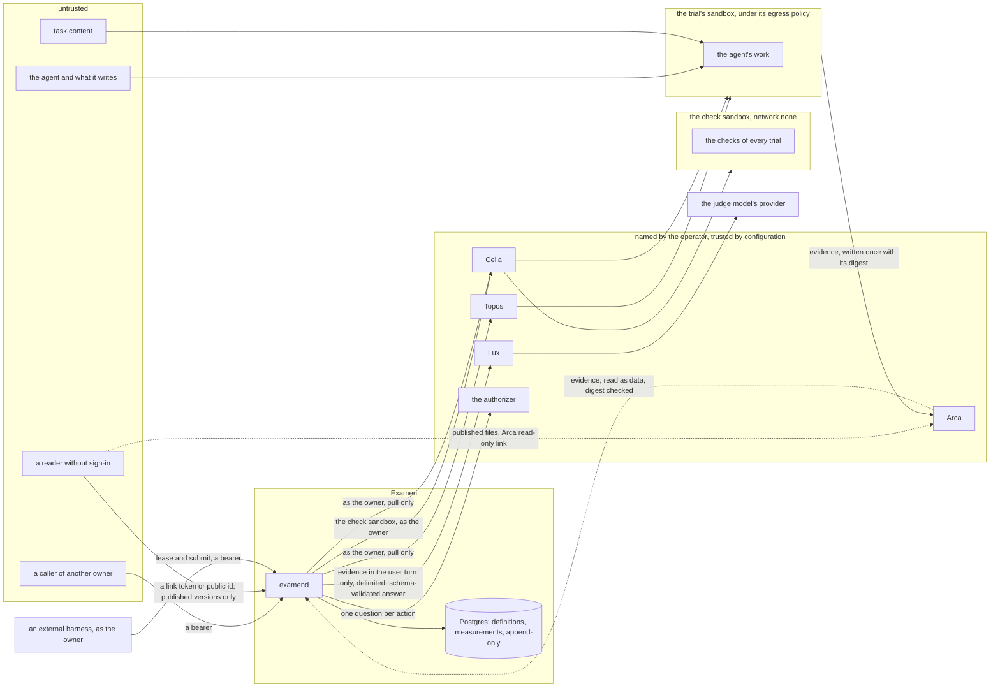

# Security and threat model

## Overview

Examen reads text nobody reviewed, the output of an agent or a program
and a task's content, and hands it to models that grade it. It spends
its owners' money, keeps evidence of their work, and holds the
measurements a release bar decides on. This spec names what is worth
taking or corrupting, who would do it, and where the boundaries are. For
each threat it states what the attacker can do, the defense, the spec
that owns the defense, and the test that holds it. A defense without a
test is a claim, so a test reads this file and holds every test it names
to one that exists.

It designs no mechanism of its own; each defense is another spec's, and
this is the place a reviewer checks that none is missing.

## Design

### What is protected

| Asset | Where it lives | What taking or changing it is worth |
|---|---|---|
| measurements and their provenance | Postgres | a release decision: an altered or forged measurement passes a bar it should fail, or hides a regression |
| the definitions: tasks, checks, rubrics, baselines | Postgres; check files in the owner's Arca space | a check or rubric the agent reads tells it how to pass without doing the work; a held-out task that leaks is spoiled |
| a task's references | the owner's Arca space, copied under `files/evals/` for each experiment | a system under test that reads the expected output passes without doing the work |
| the owner's spend | the experiment's Lux Budget | money |
| evidence: transcripts, final messages, workspace files, check outputs | the owner's Arca space; Topos session logs | the owner's code, data and prompts |
| annotations | Postgres | the ground truth judges are calibrated against |
| the owner's identity as Examen acts with it | short-lived tokens and leased Keys in examend's memory (spec 004); a Lux Key placeholder in a Cella Secret; the owner tokens of a program's credential Secrets; the export sandbox's Arca token; Arca read links, a `prepare` job's input links among them | acting as the owner at Topos, Cella, Lux and Arca, and at each API a program is given a credential for |
| examend's availability | the process and its queue | experiments and release checks wait on it |
| what an owner publishes, and what it does not | published versions and their folders in the owner's Arca space; the link tokens and Arca link tokens that reach them | a secret in published evidence reaches everyone; a captured link reaches what was meant for people holding it; content the owner did not choose to publish must stay private |

### Who acts, and how far each is trusted

| Actor | Trust |
|---|---|
| the owner, and the people the authorizer lets act on the owner's objects | trusted for those objects, as the authorizer decides |
| a caller of another owner | not trusted with this owner's objects |
| the system under test: an agent, a program, and an API a program calls | not trusted at all: it may be adversarial, may game its grading, and may be steered by what it reads |
| an external harness | the owner's own program, trusted as the owner for the owner's own experiment; what it submits, its outputs, outcome, times, provenance and self-reported values, is its claim, graded or marked and never taken as Examen's measurement |
| the HTTP runner and the comparators | Examen's own code, run inside a trial's sandbox or the check sandbox, never in examend |
| task content: instructions, workspaces, imported benchmark material | not trusted as instructions, even when the owner wrote the task, since it carries text from repositories and benchmarks |
| a check | the owner's code, trusted as the owner's; it runs over files the agent produced and may run code the agent wrote |
| a judge model and its provider | trusted to answer within its schema; trusted with data only under terms the owner accepted |
| an annotator | an authorized person, trusted to answer honestly; kept from what would bias the answer |
| Topos, Cella, Lux, Arca, the authorizer, the minter and the key endpoint | trusted by configuration: the operator named them |
| a reader who does not sign in | not trusted; reaches only published versions, through a link token or a public id, and is rate limited by address |
| the operator | trusted, and not defended against |

### Trust boundaries

Six boundaries carry the defenses:

1. **Caller to examend.** Every route verifies the bearer and asks the
   authorizer about this caller, this action and this object before it
   reads or acts (spec 004). Objects of one owner reference another's
   only through an explicit share (spec 002).
2. **The trial's sandbox to everything else.** The system under test
   runs inside the trial's sandbox, under its egress policy. In this
   release the checks of every trial run with network `none` in the check
   sandbox, where no system under test ran; the design also runs a
   `topos` trial's checks in its machine after the turn's processes are
   stopped, which waits on Topos (row 26). Nothing they
   write is executed or obeyed by examend: a check's output is parsed
   under a strict contract (spec 006), and evidence reaches a judge
   only as delimited data.
3. **examend to a judge.** Evidence enters only the user turn, inside
   blocks it cannot close, and the only answer accepted is one call of
   one schema, validated by examend.
4. **examend to the cores.** examend pulls: it calls Topos, Cella, Lux
   and Arca as the owner and serves no route any of them calls (spec
   005, contract rule 7). There is no inbound report to forge or replay.
   An external harness is a client under boundary 1, and what it submits
   is graded or marked, never believed as a measurement. examend calls
   no host a task or a candidate names.
5. **The system under test to its references.** A task's references
   reach only its checks, after every process of a `topos` trial's
   agent has stopped, or in a check sandbox the system under test never
   ran in, which a `cella` program's sandbox can neither reach nor
   cause to be filled (spec 005).
6. **A reader without sign-in to what was published.** The public
   routes answer published snapshots alone, never a live object, after
   the authorizer is asked with no subject; their files are Arca's to
   serve through links Examen created for exactly the published subset
   (spec 013).

### Threats and defenses

Each row is a requirement the code holds, with the tests that hold it,
or a requirement of the design that is not built, marked so in its test
cell. `SECURITY.md` states the built rows in a reader's words. A name in
the Test column is `<package directory>.<TestName>`, where `examen.` is
the repository root; (container) marks a test that starts Postgres.
`examen.TestNamedTestsExist` holds every name in this file and in
`SECURITY.md` to a test that exists.

| # | Who | What they can do | The defense | Spec | Test |
|---|---|---|---|---|---|
| 1 | a caller with no token, or a token Examen does not accept | reach a route as nobody, or as someone an issuer never named | a route that takes a token is refused `401` when it carries no bearer, or one from an issuer not named in `EXAMEN_OIDC_ISSUERS`, for an audience not named in `EXAMEN_OIDC_AUDIENCE`, expired by more than 30 seconds, not valid until more than 30 seconds from now, or with a signature that does not check; the answer names the verifier's reason and never repeats the token; a progress stream closes when its bearer expires | 004, 003 | `access.TestWhatTheVerifierRefuses`, `access.TestTheSkewOnExpAndNbf`, `access.TestVerifierConformance`, `httpapi.TestRoutesNeedABearer`, `httpapi.TestTheStreamCloses` (container) |
| 2 | a caller of another owner | name another owner's experiment, trial or measurement by id, or learn that it exists | under the owner policy, which decides when no authorizer is configured, every route that names a stored object answers a request with another owner's token exactly as it answers one for an object that does not exist, status, headers and body, and changes nothing; an owner acts on their own objects alone, and a create or an apply that names another owner is refused `403` | 004, 003 | `httpapi.TestAnotherOwnersTokenReachesNothing` (container), `access.TestOwnerPolicy`, `httpapi.TestReadsAcrossOwnersAndOutages` (container), `httpapi.TestARouteAsks` (container) |
| 3 | an authorizer that cannot answer | get an action done while no decision exists | a request for which the authorizer gives no well-formed decision, or an allow whose limits or filter Examen cannot read, is refused `503 authorizer_unavailable` and makes nothing; unattended work waits while the authorizer does not answer, and an experiment whose `experiment.run` is denied hands out no trial and stops; `examend` does not start when the configured authorizer allows the reserved probe question | 004 | `access.TestNoDecisionFailsClosed`, `access.TestTheLimitsOfAnAllow`, `access.TestFilters`, `access.TestNewAndTheProbe`, `httpapi.TestARouteAsks` (container), `httpapi.TestRunDeniedAndUnavailable` (container), `work.TestAdvanceDenied` (container), `examend.TestServeRefuses` (container) |
| 4 | a caller whose permission was withdrawn moments ago | keep acting on an allow already given | an allow is reused for its `ttl`, 60 seconds unless the authorizer says otherwise and 600 at most; a repeated lease asks the authorizer again before it answers with the experiment's model Key, and is refused as a first lease would be; a request repeated with the same `Idempotency-Key` within 24 hours replays the kept answer without a new question, and a progress stream asks again only when it has an event to send | 004, 003 | `httpapi.TestARepeatedLeaseAsksAgain` |
| 5 | a caller that names its own client address | have the authorizer told an address it chose, or shed the rate limit by naming another | the client address the authorizer is told comes from `X-Forwarded-For` only when the peer is in `EXAMEN_TRUSTED_PROXIES`, as the last entry no trusted proxy wrote, and is the peer's address otherwise; past the server's first handler, which runs before the request's span starts, `X-Forwarded-For` holds that address alone or is gone | 004, 011 | `httpapi.TestAuthorizerIsToldTheClientAddress`, `httpapi.TestTheSpanSeesTheTrustedClientAddress`, `access.TestAsk` |
| 6 | a caller that tries to exhaust a replica | send large bodies, many requests, slow requests, many experiments or many streams | a request body above `MAX_REQUEST_BYTES` (4 MiB) is refused `413` and nothing is made; a client address past `ADDRESS_REQUESTS_PER_MINUTE` (6,000) requests a minute to the routes that take a token on one replica is refused `429 rate_limited` with `Retry-After` before its token is read, valid or not, and a peer `EXAMEN_TRUSTED_PROXIES` does not list is counted by its own address whatever `X-Forwarded-For` it sends; a client address past `PUBLIC_REQUESTS_PER_MINUTE` (120) to `<base path>/version` and `<base path>/openapi.yaml` is refused alike; a subject past `API_REQUESTS_PER_MINUTE` (600) to one replica is refused `429 rate_limited`, and another subject is not; the server waits `READ_HEADER_TIMEOUT` (10 s) for headers and `READ_TIMEOUT` (1 minute) for the whole request, and closes idle connections after `IDLE_TIMEOUT` (2 minutes); an owner holds at most `MAX_ACTIVE_EXPERIMENTS_PER_OWNER` (16) active experiments, and a subject at most `MAX_STREAMS_PER_SUBJECT` (10) progress streams on one replica | 002, 003, 011 | `httpapi.TestRequestTooLarge`, `httpapi.TestAddressRateLimit`, `httpapi.TestRateLimit`, `examend.TestTheServerBoundsItsReads`, `httpapi.TestCreateLimits` (container), `httpapi.TestTheStream` (container), `limits.TestEveryLimitIsTheSpecs` |
| 7 | a reader of answers and logs | find a token, a Key or a secret file's content in an answer, a log line or a start error | the verifier's refusal never repeats the token; neither a served request's token nor the authorizer's bearer is in the log; a refusal at start names the variable and never repeats a value that does not parse or a secret file's content, a secret prints as nothing, and a database URL's password is not in a start error; the minter's and the key endpoint's clients put neither their bearer nor a token in an error; an error nobody classified is answered `internal` with no detail and logged under its route's pattern, never its path; every error a log line carries has its URL queries and user info cut | 004, 011 | `access.TestWhatTheVerifierRefuses`, `examend.TestServe` (container), `examend.TestServeAnnouncesWhatIsConfigured` (container), `config.TestErrorsNameTheVariableOnly`, `config.TestRefusals`, `config.TestSecretsDoNotPrint`, `examend.TestServeRefuses` (container), `owner.TestRefusalsAndOutages`, `keys.TestTheEndpointsRefusals`, `apierr.TestInternal`, `httpapi.TestRoutesNeedABearer`, `examen.TestLoggedErrorsAreCut` |
| 8 | a reader of an experiment, its log or its kept answers, after a model Key | read the experiment's model Key, or the `sign_in` handle a create carries | an experiment's model Key is in no read of the experiment, no log line and no kept answer of a repeated lease, and a leased Key prints without its value; the `sign_in` handle a create carries goes to the authorizer alone and is in no answer, read of the experiment, event or log line | 004, 003 | `httpapi.TestTheExperimentKey` (container), `httpapi.TestARepeatedLeaseKeepsNoKey` (container), `keys.TestTheEndpointLeasesAKey`, `httpapi.TestCreatePassesSignInToTheAuthorizerAlone` (container) |
| 9 | a trial that would act beyond its owner | use Examen's access to a core as anyone but the experiment's owner | every call a `topos` trial makes to Topos carries an owner token minted for the experiment's owner and for Topos, and every owner token a check or a judge asks for is minted for the experiment's owner; a token is used for `OWNER_TOKEN_MAX_LIFETIME` (15 minutes) at most; a model judge's call carries a Key leased for that judge's one model, released when the experiment ends; a check sandbox is asked for with no network egress, which Cella enforces | 004, 005, 006 | `owner.TestTokensAreKeptUntilTheirRenewal`, `owner.TestALongTokenIsUsedNoLongerThanTheMaxLifetime`, `work.TestToposRunsEachTrialAsASession` (container), `work.TestEvalsGradesARun` (container), `work.TestCheckCallsCarryAFreshOwnerToken` (container), `cella.TestTheClient` |
| 10 | an external harness that holds a lease, or a caller holding another subject's lease id | renew or submit trials another harness holds | a lease belongs to the subject that took it, and a renewal or a submit by another subject is refused with `lease_not_held` | 003, 004 | `postgres.TestStateRefusals` (container) |
| 11 | an external harness that reports on itself | report values that flatter it, or have them counted as Examen's measurements | a value an external harness reports about its own trials is marked `self_reported`, keeps its p-value, gets no q-value and no verdict, and stays out of the family of comparisons corrected together | 005, 007, 008 | `analysis.TestSelfReported`, `httpapi.TestAnalyzedImport` (container) |
| 12 | text written to sway a model judge | write into a transcript, a final message or a file text that tells the judge to ignore the rubric, give a value, add a metric or close the evidence early | a judge reads the evidence in its user turn only, inside a boundary that no input contains; its answer counts only as one call of its one tool with exactly the metrics, ranges and labels it produces, and anything else is `malformed` and yields no value; a check's output is read as strictly: a stdout that is not one object with every value is `malformed`, so a forged object beside the real one is never a pass | 006 | `grade.TestEvidenceStaysInTheUserTurn`, `grade.FuzzBoundary`, `grade.TestMalformedAnswers`, `grade.TestMalformedYieldsNothing` |
| 13 | a session that names a path outside its working directory | have a file outside it kept as the trial's evidence | a file a session's log names by an absolute path, or by one with an empty, `.` or `..` part, is left out of the trial's kept copy | 005, 007 | `topos.TestAPathOutsideTheWorkingDirectoryIsNoFile` |
| 14 | the system under test reading the answer | read a task's references before or while it works, and write them out as its outputs | a task's references reach its checks, and only its checks: not the system under test, and not a lease answer | 005, 006 | `work.TestChecksReceiveTheTasksReferences`, `work.TestAReferenceThatCannotBeDeliveredEndsTheChecks`, `work.TestASessionIsSentNoReference`, `httpapi.TestALeaseCarriesNoReference`, `httpapi.TestAnOrigoReferenceNeedsOrigoToReachItsChecks` |
| 15 | evidence that changed after its trial ended | change a kept file after the trial ended and have it graded all the same | a kept file whose bytes are not the ones recorded when the trial ended is not graded: no check runs on it and no judge is asked; a session log that is gone runs no check | 005, 007 | `work.TestEvidenceThatChanged` (container) |
| 16 | a grade or a definition rewritten after the fact | change a measurement, or a metric, grader, task, suite or candidate a measurement was made against | Postgres refuses an `UPDATE` of a measurement or of a version of a metric, grader, task, suite or candidate, and a `DELETE` of a measurement while its trial and experiment exist, so a grade once written is never overwritten; each grading ends once | 002, 007 | `postgres.TestMeasurementsAreAppendOnly` (container), `postgres.TestGradingsRunInOrderAndEndOnce` (container) |
| 17 | two encodings of one definition | pass one definition off as another, or one as two | a versioned object is named by the SHA-256 of its canonical JSON, and two encodings of one object give one digest | 002 | `id.TestCanonicalGolden`, `id.TestDigestIgnoresOrderAndSpace` |
| 18 | a comparison chosen after the results | run many comparisons and report the one that came out | comparisons declared at create, before any trial runs, are corrected together as one family; a comparison asked for afterwards is marked exploratory and has no result tested alone, since its primary metric is corrected with the rest; a comparison is final only once computed after the experiment ends | 008 | `analysis.TestPrimaryStandsAlone`, `analysis.TestExploratory`, `analysis.TestDeclaredComparison`, `httpapi.TestComparisons` (container), `httpapi.TestDeclaredComparisonsRefused` (container), `httpapi.TestAComparisonIsFinalOnceComputedAfterTheEnd` (container) |
| 19 | a result that differs on another machine | publish a verdict another machine cannot reproduce | one golden comparison has a fixed SHA-256 digest; the analysis uses only operations IEEE 754 defines exactly and its own vendored functions, with no product the compiler could fuse with an add; a final comparison recomputed from its recorded inputs is byte-identical | 008 | `analysis.TestGoldenAcrossArchitectures`, `analysis.TestUsesVendoredMath`, `analysis.TestNoFusedMultiplyAdd`, `analysis.TestRecomputeFromRecordedInputs` |
| 20 | the network between Examen and the services it calls | read or alter what Examen sends over plain `http` | an issuer, the authorizer, the minter, the key endpoint, Topos, Cella, Lux, Arca or Origo named over plain `http` stops the start unless its host is `localhost` or a loopback address | 011 | `config.TestRefusals` |
| 21 | a client presenting a label as Examen's | label a task or an experiment as a trial Examen ran | a `metadata` key beginning `examen.` that a client supplies is refused `400 invalid_field`; the prefix is reserved for the labels Examen writes | 002, 003 | `objects.TestNamesAndRefs`, `httpapi.TestCreateRefusals` |
| 22 | a write sent twice | append a create twice | a create sent twice with one `Idempotency-Key` appends once and replays the kept answer | 003 | `httpapi.TestIdempotency` |
| 23 | a program that names an audience Examen acts through | take the owner's access to Topos, Cella, Lux or Arca for a program | a program candidate's credential for an audience Examen acts through is refused at apply with `credential_audience_reserved`; the authorizer is told the judge models and credential audiences an experiment names (`judge_models`, `credential_audiences`) and may hold them to a list. A model judge without a model is refused at apply, and Examen ships no default judge model | 002, 004 | `objects.TestCandidateRules`, `httpapi.TestApplyPreconditionsAndRefusals`, `access.TestTheLimitsOfAnAllow`, `objects.TestGraderRules` |
| 24 | a judge, a loop or a large experiment | spend the owner's money past what was meant | the limits of spec 002 bound the trials, cells, candidates, parallelism and the judge's input and output; a trial that ends `over_budget` parks its cell until a retry; an experiment's Keys are released when it ends | 002, 005, 006 | `httpapi.TestCreateLimits` (container), `httpapi.TestOverBudgetParksAndRetryReopens`, `keys.TestTheEndpointsBudgetReleaseAndUsage`, `limits.TestEveryLimitIsTheSpecs` |

The rows below are in the design and not built in this release. None
has a test; each is marked `Not built`.

| # | Who | What they can do | The defense | Spec | Test |
|---|---|---|---|---|---|
| 25 | hostile evidence reaching an agent judge | steer the judge agent to change the evidence, reach out of its machine, or answer for another trial | its inputs are read-only and outside its working directory, its machine's network is `none`, its tools are narrowed to reading ones, one session judges one trial, and its answer is validated like a model judge's. An agent judge validates at apply and is never run | 006, 005 | Not built |
| 26 | a check that lies, or agent code a check runs | report a value that is not true, or send the workspace somewhere | checks run in the check sandbox with network `none` (row 9), never in examend. The design also runs a `topos` trial's checks in its own machine after the turn's processes stop, which waits on Topos | 005, 006 | Not built |
| 27 | a caller of another owner, through a share | read through a shared suite, baseline or experiment | every share grants reading alone; a shared baseline gives summaries and never evidence. No route makes a share | 004, 006 | Not built |
| 28 | an annotator's bias, or one annotator outvoting others | label after seeing the candidate, or answer one item many times | an annotator never sees the candidate or another's answer; each counts once in a consensus. Annotation answers are not served | 006 | Not built |
| 29 | a program given a credential | use the owner token it was given elsewhere or after its trial | the sandbox holds a placeholder that Cella's egress gateway swaps only on a request to the credential's `host`; the value is renewed in place and deleted at the rollout's end. Apply checks the credential's audience (row 23); no program is run with one | 004, 005, 003 | Not built |
| 30 | an owner presenting a topos or cella session as another candidate's | import a session and claim it ran another agent or model | provenance is read from the core's records. An import of a `topos` or `cella` run answers `core_not_configured`; an `external` import is the harness's claim (row 11) | 005, 003 | Not built |
| 31 | a task or a candidate that names a host | make examend call an internal address | examend makes no request to a host a task or a candidate names, and its egress names only its configured endpoints. No test records outbound requests | 005, 011 | Not built |
| 32 | an external harness's output archive | send an archive that expands without bound, or holds a path out of the output directory | an archive is read as a stream with its digest checked and refused whole for a link or a path leaving the directory. Outputs are recorded unread in this release | 005 | Not built |
| 33 | a Volume reused by name and changed at the core | run another image than the one a candidate or grader pins | a Volume named from an image digest is attached only after its source digest is read and found equal, at every attach | 005 | Not built |
| 34 | a secret in what an owner publishes, a captured link, a reader without sign-in, a submitter flattering its entry, a published page that runs script | publish a credential, read what was not shared, probe for keys, enter a benchmark with self-reported values, or run script from a published file | publications, their secret scan, link tokens, public reads, benchmark submissions and the download-only requirement (spec 013). No route serves any of them | 013, 004, 011 | Not built |

### What is not defended

What `SECURITY.md` lists, and what the design leaves to the owner.

- **Routes that take no token.** `/livez`, `/readyz` and `/version` at
  the listener's root, `GET <base path>/version` and
  `GET <base path>/openapi.yaml` answer anyone, and so does the `404` of
  a path Examen does not serve and the `413` of a body above the bound.
  The probes are not rate limited; the version and the contract below
  the base path are held to `PUBLIC_REQUESTS_PER_MINUTE` from one client
  address (row 6).
- **A permission withdrawn moments ago,** except a repeated lease (row 4).
- **What a deny says.** The authorizer's reason for a `403` is returned
  to the caller in `details.reason`, and so is a key source's reason for
  refusing a Key.
- **Every audience listed.** A token for any audience in
  `EXAMEN_OIDC_AUDIENCE` is accepted.
- **Load beyond one replica's limits.** The request rates and the
  stream count are counted per replica in memory, so each replica added
  allows as much again. Behind a proxy `EXAMEN_TRUSTED_PROXIES` does not
  list, every client has the proxy's address and shares its rate. The
  server sets no write timeout, which would cut progress streams, so a
  client that reads an answer slowly holds its connection. Postgres
  grows without bound: Examen removes only idempotency keys and a
  provisional comparison's list of inputs.
- **A judge swayed within its schema.** Row 12 keeps hostile text from
  changing the shape of a judgment or reaching anything, not from
  moving a value inside the allowed range. A transcript holds the task's
  instruction and every tool's output. Calibration against people is how
  such drift is seen, after the fact.
- **A check written to trust what the agent controls,** such as one that
  passes the output of the agent's own tests through as its result.
  The contract makes a crude forgery `malformed`; it cannot make a
  careless check sound.
- **An agent that wrecks its own trial,** killing its sandbox so the
  trial ends `infra_failed` rather than failed. Such a trial is retried,
  and an index that runs out of retries is reported per cell as lost
  and never read as a success (spec 008); the bias that selective
  wrecking introduces is visible, not prevented.
- **A provider that breaks its stated terms.** The owner chooses the
  model; what its provider does inside or against its terms is the
  provider's.
- **A secret the agent read from its workspace and printed.** It is in
  the evidence the owner's own run produced.
- **The services Examen is configured with, and the operator.** Topos,
  Cella, Lux, Arca, the minter, the key endpoint, the authorizer and the
  issuers are believed. Examen checks a session log against the digest
  it recorded when the trial ended, not against Topos's own record.
  Cella, not Examen, holds a check sandbox without network.
- **An authorizer that answers wrongly,** or an issuer that signs a
  token for the wrong subject. Examen refuses when no decision arrives
  and follows the one that does. It asks the probe question once, at
  start, and starts when the authorizer does not answer it; requests
  then fail closed until it does.
- **An external harness's honesty.** Its outputs are recorded unread,
  and checks and model judges grade `topos` trials only. It holds the
  experiment's model Key and can spend the Budget on any model that Key
  allows. What it reports about itself is marked `self_reported` and
  declared, not checked.
- **The database's owner.** The triggers refuse statements, not the
  role that owns the tables, which is the role `examend migrate` ran as.
  A role that can drop a trigger can rewrite measurements, and Examen
  does not notice. A role that can delete an experiment's or a trial's
  row removes its measurements with it.
- **What telemetry carries.** With `OTEL_EXPORTER_OTLP_ENDPOINT` set,
  server spans hold the request path with object ids and names, the user
  agent and the client address. Client spans hold each outbound URL's
  scheme, host and path, never its query.
- **Error text from libraries.** A log line's error has its URL queries
  and user info cut, but one a library wrote can still name the host and
  path of an issuer, the authorizer or a service. A handler that panics
  logs the peer's address and a stack.
- **Denial of service beyond rows 6 and 24.**

### Reporting

`SECURITY.md` names a private channel for a report, asks that no public
issue be opened for one, and says when a reporter hears back. It lists
what the project commits to, each commitment one row of the table above
in a reader's words, and what is not defended, as the list above. A
commitment whose test is not written is not listed.
`examen.TestNamedTestsExist` reads both files and holds every test they
name to one that exists; that each commitment has a row is not tested.

### Limits

The constants of spec 002 this spec names: `MAX_REQUEST_BYTES`,
`API_REQUESTS_PER_MINUTE`, `ADDRESS_REQUESTS_PER_MINUTE`,
`PUBLIC_REQUESTS_PER_MINUTE`, `READ_HEADER_TIMEOUT`, `READ_TIMEOUT`,
`IDLE_TIMEOUT`, `MAX_STREAMS_PER_SUBJECT`,
`MAX_ACTIVE_EXPERIMENTS_PER_OWNER`, `OWNER_TOKEN_MAX_LIFETIME`,
`MAX_TRIALS_PER_CELL`, `MAX_CELLS_PER_EXPERIMENT`,
`MAX_CANDIDATES_PER_EXPERIMENT`, `MAX_PARALLELISM`, `MAX_TRIAL_TIMEOUT`,
`JUDGE_MAX_INPUT_BYTES`, `JUDGE_MAX_OUTPUT_TOKENS`, `JUDGE_MAX_ATTEMPTS`,
`COST_ESTIMATE_MARGIN`, `MAX_OUTPUT_FILES`, `MAX_OUTPUT_BYTES`,
`OUTPUT_FILE_KEEP_MAX_BYTES` and `INPUT_LINK_TTL`.

## Not in this spec

The mechanisms themselves: verification, the authorizer's questions,
sharing and acting as the owner (spec 004); the executors, the driver
and evidence writing (spec 005); checks, judges and annotations (spec
006); evidence references and retention (spec 007); lost indices in a
verdict (spec 008); the routes, their errors and paging (spec 003);
the container's confinement and configuration (spec 011); publications,
their scan, links and public reads (spec 013). The defenses inside
Topos, Cella, Lux and Arca are their own threat models.

## Acceptance criteria

| Criterion | Test that proves it |
|---|---|
| Every test that `SECURITY.md` and this spec name is declared by a `_test.go` file of the package it names | `examen.TestNamedTestsExist` |
| Every request to a route that takes a token is refused without a valid bearer | `httpapi.TestRoutesNeedABearer`, `access.TestWhatTheVerifierRefuses` |
| With another owner's token, every route that names a stored object answers as it would for an object that does not exist, and nothing changes | `httpapi.TestAnotherOwnersTokenReachesNothing` (container) |
| A request the authorizer gives no decision on is `503 authorizer_unavailable` and makes nothing | `access.TestNoDecisionFailsClosed`, `httpapi.TestARouteAsks` (container) |
| A repeated lease asks the authorizer again before it answers the model Key | `httpapi.TestARepeatedLeaseAsksAgain` |
| A body above `MAX_REQUEST_BYTES` is refused, and a client address or a subject past its rate is `429 rate_limited` | `httpapi.TestRequestTooLarge`, `httpapi.TestAddressRateLimit`, `httpapi.TestRateLimit` |
| The server bounds the time it waits for headers, for the whole request and for an idle connection | `examend.TestTheServerBoundsItsReads` |
| An experiment's model Key is in no read, log line or kept answer | `httpapi.TestTheExperimentKey` (container), `httpapi.TestARepeatedLeaseKeepsNoKey` (container) |
| Evidence stays in a judge's user turn, and an answer that is not one valid call is `malformed` | `grade.TestEvidenceStaysInTheUserTurn`, `grade.FuzzBoundary`, `grade.TestMalformedAnswers` |
| An `UPDATE` of a measurement or a version, and a `DELETE` of a measurement, is refused by the database | `postgres.TestMeasurementsAreAppendOnly` (container) |
| A kept file that changed after its trial ended is not graded | `work.TestEvidenceThatChanged` (container) |
| A renewal or a submit by a subject other than the lease's is `lease_not_held` | `postgres.TestStateRefusals` (container) |
| A value an external harness reports about itself has no verdict and is outside the corrected family | `analysis.TestSelfReported`, `httpapi.TestAnalyzedImport` (container) |
| A task's references reach its checks, and only its checks | `work.TestChecksReceiveTheTasksReferences`, `work.TestAReferenceThatCannotBeDeliveredEndsTheChecks`, `work.TestASessionIsSentNoReference`, `httpapi.TestALeaseCarriesNoReference`, `httpapi.TestAnOrigoReferenceNeedsOrigoToReachItsChecks` |
| A final comparison recomputed from its recorded inputs is byte-identical on every architecture | `analysis.TestGoldenAcrossArchitectures`, `analysis.TestRecomputeFromRecordedInputs` |
| A metadata key under `examen.` supplied by a client is refused | `objects.TestNamesAndRefs`, `httpapi.TestCreateRefusals` |
| A program credential for an audience Examen acts through is refused at apply | `objects.TestCandidateRules`, `httpapi.TestApplyPreconditionsAndRefusals` |

## Outcome

In progress. The boundary between callers and examend, the grading
path and the measurements are built; publishing, shares, annotations,
agent judges, program credentials and the import of Topos and Cella
runs are not. What runs, with `SECURITY.md` as the statement of it:

- **Callers.** Bearer verification of issuer, audience and validity
  times with a 30 second skew; one question to the authorizer, or the
  owner policy, on every route, with a deny answered as a missing object
  and no decision answered `503`; a repeated lease asks again; the
  client address is trusted only through `EXAMEN_TRUSTED_PROXIES`.
- **Limits.** The body bound, the rate per client address (before the
  token is read) and per subject, the header, read and idle timeouts,
  the stream bound and the bound on active experiments.
- **Secrets.** Tokens, Keys, secret files and the `sign_in` handle
  stay out of answers, logs and rows; a log line's error has its URL
  cut.
- **Acting as the owner.** Owner tokens minted for the experiment's
  owner and one audience, used 15 minutes at most; Keys leased from the
  `endpoint` key source and released; checks and model judges of
  `topos` trials, with checks in a check sandbox with no network.
- **Evidence and measurements.** A kept file checked against the digest
  recorded at the trial's end; measurements and versions refused an
  update by the database; declared comparisons, exploratory ones and
  the bit-exact analysis.

Rows 1 to 24 are built. Rows 25 to 34 are not
built: an agent judge validates at apply and is never run (25); a
`topos` trial's checks run in the check sandbox, not in its own machine
(26); shares, annotation answers, program credential delivery, the
import of Topos and Cella runs, archives of an external harness's
outputs, Volumes and publications (27 to 34) have no route or executor.

| # | Verdict | Held by |
|---|---|---|
| 1 to 13, 15 to 22 | Met | the tests of each row |
| 14 | Met: text, Arca and Origo references reach the check sandbox alone, all of them or none, within `REFERENCE_MAX_BYTES` together; a Topos session and a lease carry none | `work.TestChecksReceiveTheTasksReferences`, `work.TestAReferenceThatCannotBeDeliveredEndsTheChecks`, `work.TestASessionIsSentNoReference`, `httpapi.TestALeaseCarriesNoReference`, `httpapi.TestAnOrigoReferenceNeedsOrigoToReachItsChecks` |
| 23 | Partly met: apply refuses a reserved audience and a model judge without a model; the authorizer is told the models and audiences; no test shows the authorizer's list being enforced beyond that question | `objects.TestCandidateRules`, `httpapi.TestApplyPreconditionsAndRefusals`, `access.TestTheLimitsOfAnAllow`, `objects.TestGraderRules` |
| 24 | Partly met: the limits of spec 002 are enforced and a spend refusal parks the cell; no test shows a Key drawing on the experiment's Budget by construction | `httpapi.TestCreateLimits` (container), `httpapi.TestOverBudgetParksAndRetryReopens`, `keys.TestTheEndpointsBudgetReleaseAndUsage` |
| 25 to 34 | Not met: not built | none |
