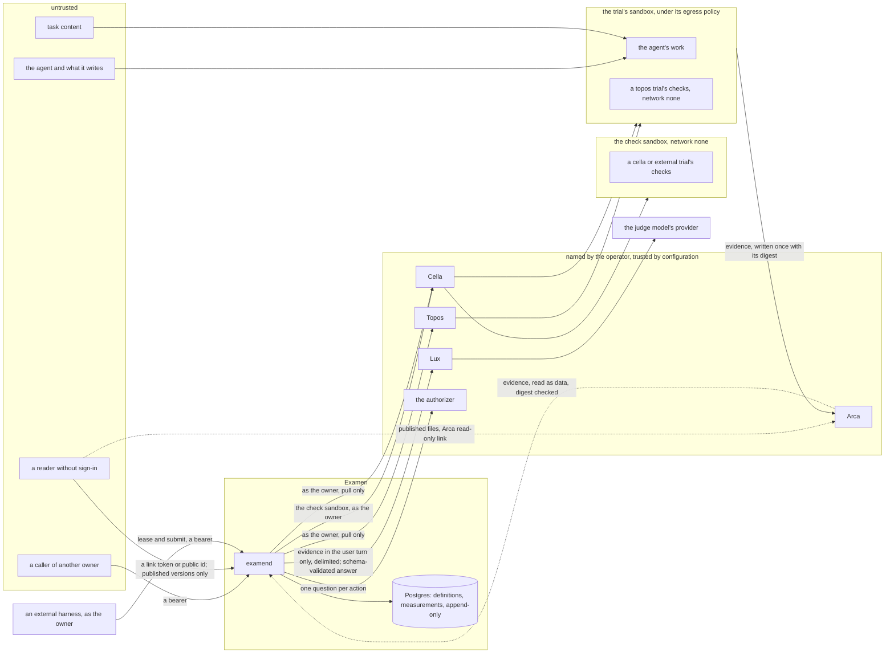

# Security and threat model

## Overview

Examen reads text nobody reviewed, the output of an agent or a program
and a task's content, and hands it to models that grade it. It spends
its owners' money, keeps evidence of their work, and holds the
measurements a release bar decides on. This spec names what is worth
taking or corrupting, who would do it, and where the boundaries are. For
each threat it states what the attacker can do, the defense, the spec
that owns the defense, and the test that holds it. A defense without a
test is a claim, so a test reads this file and holds every test it names
to one that exists.

It designs no mechanism of its own; each defense is another spec's, and
this is the place a reviewer checks that none is missing.

## Design

### What is protected

| Asset | Where it lives | What taking or changing it is worth |
|---|---|---|
| measurements and their provenance | Postgres | a release decision: an altered or forged measurement passes a bar it should fail, or hides a regression |
| the definitions: tasks, checks, rubrics, baselines | Postgres; check files in the owner's Arca space | a check or rubric the agent reads tells it how to pass without doing the work; a held-out task that leaks is spoiled |
| a task's references | the owner's Arca space, copied under `files/evals/` for each experiment | a system under test that reads the expected output passes without doing the work |
| the owner's spend | the experiment's Lux Budget | money |
| evidence: transcripts, final messages, workspace files, check outputs | the owner's Arca space; Topos session logs | the owner's code, data and prompts |
| annotations | Postgres | the ground truth judges are calibrated against |
| the owner's identity as Examen acts with it | short-lived tokens and leased Keys in examend's memory (spec 004); a Lux Key placeholder in a Cella Secret; the owner tokens of a program's credential Secrets; the export sandbox's Arca token; Arca read links, a `prepare` job's input links among them | acting as the owner at Topos, Cella, Lux and Arca, and at each API a program is given a credential for |
| examend's availability | the process and its queue | experiments and release checks wait on it |
| what an owner publishes, and what it does not | published versions and their folders in the owner's Arca space; the link tokens and Arca link tokens that reach them | a secret in published evidence reaches everyone; a captured link reaches what was meant for people holding it; content the owner did not choose to publish must stay private |

### Who acts, and how far each is trusted

| Actor | Trust |
|---|---|
| the owner, and the people the authorizer lets act on the owner's objects | trusted for those objects, as the authorizer decides |
| a caller of another owner | not trusted with this owner's objects |
| the system under test: an agent, a program, and an API a program calls | not trusted at all: it may be adversarial, may game its grading, and may be steered by what it reads |
| an external harness | the owner's own program, trusted as the owner for the owner's own experiment; what it submits, its outputs, outcome, times, provenance and self-reported values, is its claim, graded or marked and never taken as Examen's measurement |
| the HTTP runner and the comparators | Examen's own code, run inside a trial's sandbox or the check sandbox, never in examend |
| task content: instructions, workspaces, imported benchmark material | not trusted as instructions, even when the owner wrote the task, since it carries text from repositories and benchmarks |
| a check | the owner's code, trusted as the owner's; it runs over files the agent produced and may run code the agent wrote |
| a judge model and its provider | trusted to answer within its schema; trusted with data only under terms the owner accepted |
| an annotator | an authorized person, trusted to answer honestly; kept from what would bias the answer |
| Topos, Cella, Lux, Arca, the authorizer, the minter and the key endpoint | trusted by configuration: the operator named them |
| a reader who does not sign in | not trusted; reaches only published versions, through a link token or a public id, and is rate limited by address |
| the operator | trusted, and not defended against |

### Trust boundaries

Six boundaries carry the defenses:

1. **Caller to examend.** Every route verifies the bearer and asks the
   authorizer about this caller, this action and this object before it
   reads or acts (spec 004). Objects of one owner reference another's
   only through an explicit share (spec 002).
2. **The trial's sandbox to everything else.** The system under test
   runs inside the trial's sandbox, under its egress policy. The checks
   run with network `none`: a `topos` trial's in its machine after the
   turn's processes are stopped, and a `cella` or `external` trial's in
   the check sandbox, where no system under test ran. Nothing they
   write is executed or obeyed by examend: a check's output is parsed
   under a strict contract (spec 006), and evidence reaches a judge
   only as delimited data.
3. **examend to a judge.** Evidence enters only the user turn, inside
   blocks it cannot close, and the only answer accepted is one call of
   one schema, validated by examend.
4. **examend to the cores.** examend pulls: it calls Topos, Cella, Lux
   and Arca as the owner and serves no route any of them calls (spec
   005, contract rule 7). There is no inbound report to forge or replay.
   An external harness is a client under boundary 1, and what it submits
   is graded or marked, never believed as a measurement. examend calls
   no host a task or a candidate names.
5. **The system under test to its references.** A task's references
   reach only its checks, after every process of a `topos` trial's
   agent has stopped, or in a check sandbox the system under test never
   ran in, which a `cella` program's sandbox can neither reach nor
   cause to be filled (spec 005).
6. **A reader without sign-in to what was published.** The public
   routes answer published snapshots alone, never a live object, after
   the authorizer is asked with no subject; their files are Arca's to
   serve through links Examen created for exactly the published subset
   (spec 013).

### Threats and defenses

| # | Who | What they can do | The defense | Spec | Test |
|---|---|---|---|---|---|
| 1 | hostile agent output or task content reaching a model judge | write into its transcript, final message or files text that tells the judge to ignore the rubric, give a value, add a metric, or end the evidence early with a forged marker | evidence is read as data and never as instructions: it is placed only in the user turn, each input in a block whose boundary is chosen after the content is fixed and occurs in none of it, so no content closes its block; the system content is the preamble, the prompt, the rubric and the metric list, and never a byte of evidence, the task's instruction included; the judge has one tool, `record_judgment`, and examend accepts only one call of it, validated against the schema, the ranges, the labels and the rationale bound, so injected text cannot add a metric, change a type or reach anything; temperature and model are pinned; calibration against people flags a judge whose agreement falls | 006 | `TestCanaryNeverInSystemContent`, `judge.TestEvidenceStaysInTheUserTurn`, `judge.FuzzBoundary`, `TestAnObedientJudgeCannotChangeTheSchema` |
| 2 | hostile evidence reaching an agent judge | steer the judge agent to change the evidence, reach out of its machine, or answer for another trial | its inputs are read-only and outside its working directory, its machine's network is `none`, its tools are narrowed to reading ones with no connection, one session judges one trial, and its answer is read only from that session's own evidence and validated like a model judge's | 006, 005 | `judge.TestAgentJudge`, `TestAnAgentJudgeCannotReachOut` |
| 3 | the agent gaming its own grading | edit a check's files, leave a process that rewrites check results while checks run, write a fake result file in advance, print a forged result that a check passes through | on `topos` a check trusts no file the agent could change: its files are in the image at a path the sandbox's user cannot write, or delivered read-only from a pinned Arca folder after the turn, and every process the agent started is stopped before the first check; a `cella` or `external` trial's checks run in a check sandbox the system under test never ran in, which holds only what examend wrote; a check's stdout must be exactly one object with every metric, so a forged object beside the real one is `malformed`, never a pass; the whole stdout is kept in evidence, so a result can be audited | 006, 005 | `TestAForgedSecondObjectIsMalformed`, `cella.TestChecksInTheCheckSandbox`, `TestCheckFilesAreReadOnly`, `TestALeftoverProcessCannotTouchResults` |
| 4 | a check that lies or exfiltrates, or agent code it runs | report a value that is not true, send the workspace somewhere, spend on the model | a check runs only in a `topos` trial's machine or in a check sandbox, with network `none`, and never in examend, which parses and never executes; a check holds no model key and no owner credential; a value is the check's owner's claim, kept with its stdout; agent code that reads the key's placeholder from another process can spend only through Lux's host, on the candidate's model, under the hard Budget, and the spend carries no trial's label and is reported as the rollout's unattributed usage | 005, 006 | `check.TestEnvironment`, `execute.TestCheckPhaseHasNoNetwork`, `TestExamendExecutesNothing`, `luxread.TestCostFromRecords` |
| 5 | cost exhaustion: an agent that loops, a model dearer than expected, a judge over large evidence, a large experiment, many experiments | spend the owner's money past what was meant | one hard Lux Budget per experiment, a soft one refused by the `lux` key source; every Key the key source leases or a core issues for the experiment draws on it, and on any Budget an installation adds above it, and allows no unpriced model; with the `endpoint` source Examen writes no Key or Budget, so a cap a budget owner set at the installation cannot be bypassed; smoke trials and the cost check against the smallest remainder across those Budgets, with `COST_ESTIMATE_MARGIN`, before any cell spends at scale; the limits `MAX_TRIALS_PER_CELL`, `MAX_CELLS_PER_EXPERIMENT`, `MAX_CANDIDATES_PER_EXPERIMENT`, `MAX_PARALLELISM`, `MAX_TRIAL_TIMEOUT`, `JUDGE_MAX_INPUT_BYTES`, `JUDGE_MAX_OUTPUT_TOKENS`, `JUDGE_MAX_ATTEMPTS` and `MAX_ACTIVE_EXPERIMENTS_PER_OWNER`; a refused request ends the trial `over_budget`, which parks its cell and is never retried automatically; a cancel releases the experiment's Keys | 005, 006, 004, 002 | `queue.TestCostCheck`, `queue.TestBudgetRunsOut`, `queue.TestUnpricedBlocks`, `TestSoftBudgetRefused`, `judge.TestJudgeKey`, `TestEveryKeyDrawsOnTheBudget`, `TestActiveExperimentsAreBounded` |
| 6 | a caller of another owner, or a share used too widely | name another owner's experiment, trial, evidence or annotation queue by id; read through a shared suite or baseline; adopt or import across owners | every route asks the authorizer before it reads or acts, and with no authorizer an owner reaches only their own objects; a deny on a stored object answers as its absence, so an id is not confirmed; a shared baseline gives its reader the comparison's summaries and never its trials' evidence, a shared suite gives its definitions and never another owner's experiments, and no grantee runs an experiment, pins a baseline or applies a bar on a shared suite or names a shared baseline, since every share grants reading alone, and a shared experiment or publication gives reading and never evidence bytes beyond what a published version carries, which Arca grants; no action that runs an experiment rests on a share, so a reader neither spends the owner's budget nor feeds or changes its results, and a published benchmark runs on its owner's side alone; adoption never crosses owners; an import reads the core's records as the owner, so what the owner cannot read cannot be imported; evidence is written to and read from the owner's own Arca space with the owner's identity; annotators see only items of experiments the authorizer lets them answer | 004, 005, 006, 013 | `TestAnotherOwnersTokenReachesNothing`, `access.TestASharedExperimentDoesNotRun`, `access.TestAShareOpensReadsAlone`, `queue.TestAdoption`, `TestASharedBaselineExposesNoEvidence`, `TestImportIsAskedAsTheOwner` |
| 7 | a judge's provider, and evidence that holds secrets | keep or train on the transcripts and files a judge sends; read a credential the agent printed | the owner chooses every judge model, the decline judge's included, Examen ships no default judge model, and the built-in decline judge calls no model; an authorizer holds judges to the models whose terms an owner accepts with `judge_models`; a judge's Key comes from the key source, which decides its data terms, so an installation's key endpoint can hold it to providers that keep nothing when the owner asks for that; a judge reads only the inputs its grader names, within `JUDGE_MAX_INPUT_BYTES`; model keys reach a machine only as placeholders the egress gateway swaps, so an agent cannot print one into evidence; evidence stays in the owner's Arca space and Topos | 006, 005, 004 | `judge.TestJudgeKey`, `TestNoDefaultJudgeModel`, `TestNoKeyValueInEvidence` |
| 8 | a writer of the database, a client, a faulty executor, an overwrite in Arca | change a measurement, rewrite a trial's result, swap the evidence a judge reads | measurements are append-only: no route updates or deletes one, and the database refuses an update or delete of a measurement row from examend's own role; versioned objects are named by the digest of their canonical JSON and every reference pins one; a `done` trial is final and a report that differs is refused; evidence is written once (`If-None-Match: *`) with its SHA-256 taken when it is reported, and every read for grading checks it, ending in `evidence_changed` on a mismatch; comparisons and bar evaluations are computed, recorded with what they read, and never written by a client | 002, 005, 006 | `TestMeasurementsAreAppendOnly`, `execute.TestReportsOnlyMoveForward`, `judge.TestEvidenceChanged`, `TestDigestsAreCanonical` |
| 9 | someone holding a captured token or link | replay a caller's bearer, an acting-as-owner token, the export sandbox's Arca token, a read link, a Lux Key; send a write twice | examend checks issuer, audience and expiry on every request and keeps no caller's token; a token it obtains to act as the owner is short-lived, bound to one core's audience, held in memory and never logged or stored (spec 004); examend serves no route a core calls, so there is no report to replay; every write that creates (apply, run, re-grade, annotation answer) carries a key and appends once; the export token lasts the export and is scoped by its Secret to Arca's host; a read link names one folder and expires at the trial's deadline; an input link a `prepare` job mints names one object or folder, expires after `INPUT_LINK_TTL`, stays in Postgres only while the job runs, is revoked when it ends and is scrubbed from every span; a rollout's Key is released when the rollout ends, and a judge's when the experiment ends | 004, 005, 006, 011 | `TestStaleOrForeignTokenRefused`, `TestNoInboundExecutorRoute`, `TestReplayedWriteAppendsOnce`, `cella.TestRolloutKeyReleasedAtEnd`, `execute.TestPrepareThroughBenchmarkLinks` |
| 10 | a caller flooding the API | send large bodies, many requests, many experiments, or requests whose answer is costly to compute | a body ends at `MAX_REQUEST_BYTES`; a subject makes at most `API_REQUESTS_PER_MINUTE` requests to one replica, through `pkg/ratelimit`; an owner holds at most `MAX_ACTIVE_EXPERIMENTS_PER_OWNER` experiments not `complete` or `canceled`; every list is paged; every limit of spec 002 is enforced at apply; comparisons are computed by jobs and stored, so a read serves a stored result; a slow core holds only its own jobs' leases | 002, 003, 005 | `TestBodyBound`, `TestRateLimit`, `TestActiveExperimentsAreBounded`, `TestLimitsAreEnforcedAtApply` |
| 11 | an owner, or a forged label, presenting trials as what they are not | import a session and claim it ran another agent or model; label a session as an Examen trial; mix chosen samples into an executed cell | provenance of an imported trial is read from the core's records, never from the request, and an import whose records differ from the tuple of the task and candidate it names, or do not pin a field, is refused, so a trial joins only the cell of its own tuple; an imported trial is marked, never adopted, and lives only in an experiment of mode `import`, which runs nothing; the prefix `examen.` is refused on every label a client supplies | 005, 003 | `topos.TestImport`, `TestReservedLabelsRefused` |
| 12 | an annotator's bias, or one annotator outvoting others | label after seeing the candidate's name or a judge's value; answer the same item many times | an annotator never sees the candidate, another grader's measurements or another person's answer; each annotator counts once in a consensus, by their latest answer | 006 | `annotate.TestBlindAnswers`, `calibrate.TestOneVotePerAnnotator` |
| 13 | the system under test reading the answer | read a task's references before or while it works, and write them out as its outputs | references are delivered only to checks: on `topos` after every process of the turn is stopped (R8); for a `cella` or `external` trial only into the check sandbox, which examend starts after the export or the submit and which the program's sandbox can neither reach nor trigger, and never in a lease answer; inputs and references are separate folders, so a link to the inputs reaches no reference | 005, 006 | `cella.TestChecksInTheCheckSandbox`, `topos.TestReferencesOnlyForChecks`, `external.TestLeaseCarriesNoReference` |
| 14 | a program given a credential, or code it runs | take the owner token it was given and use it elsewhere or after its trial | a credential is never for an audience Examen acts through, a core's or its own, which is refused at apply, so a program never acts toward the services that run, meter, keep or grade it; it reaches only a candidate whose audience the authorizer's `credential_audiences` lists, and none without an authorizer; it is minted for one audience with the purpose `trial` and lasts at most `OWNER_TOKEN_MAX_LIFETIME`; the sandbox holds only a placeholder, which Cella's egress gateway swaps for the value only on a request to the credential's `host`; the value is renewed in place and deleted at the rollout's end, and is never in Postgres, an event, a log line or an error | 004, 005, 003 | `cella.TestCredentialSecrets`, `TestNoCredentialValueAnywhere`, `TestReservedCredentialAudienceRefused` |
| 15 | a task or a candidate that names a host | make examend call an internal address or any host: an API under evaluation, a version endpoint, an input's source | examend makes no request to a host a task or a candidate names: an API is called by the HTTP runner inside the trial's sandbox, under that sandbox's network policy; every input and reference comes from Arca or Origo through the owner's identity, and inline text from the task; examend's own egress names only its configured endpoints | 005, 011 | `TestExamendCallsNoNamedHost` |
| 16 | an external harness | submit false outputs, outcomes or times, self-report values that flatter it, or leave model calls out of its attribution | its outputs are graded by the task's checks in a check sandbox, as any trial's are; its provenance is declared, and every comparison that reads it lists that side in `declared_provenance`; a self-reported value is stored under `self:<harness>`, only for a metric no grader produces, carries `self_reported` on every result it enters, which then has no verdict and stays outside the corrected family, is never headlined, fails a bar, and leaves a benchmark entry unranked; a call it neither lists nor labels is not counted. The rest is its owner's own experiment | 005, 007, 008, 009, 010 | `external.TestSelfReported`, `analysis.TestSelfReported`, `analysis.TestDeclaredProvenance`, `bar.TestSelfReportedFailsClosed` |
| 17 | a caller holding another subject's lease id | submit or renew trials another external harness holds | a lease belongs to the subject that took it, and a renewal or a submit by another subject is `409 lease_not_held`; each asks `trial.lease` or `trial.submit` of the experiment, so another owner's caller reaches nothing | 003, 004 | `external.TestForeignLease`, `TestAnotherOwnersTokenReachesNothing` |
| 18 | a secret in what an owner publishes | an agent printed a credential into a transcript or an output, and the owner publishes it at `outputs` or `full` | before any link exists, a secret scan from Examen's pinned scanner image runs in a Cella sandbox with network `none` over the version's snapshot JSON at every evidence level, definitions with their `env`, headers and inline inputs included, and over every file the version would publish; a file the scanner cannot read is a finding; a finding blocks the version, names the file and rule and never the matched text, and a new version must exclude the file; `aggregates` publishes no trial content | 013 | `publish.TestSecretScanBlocks`, `publish.TestSnapshotIsScanned` |
| 19 | someone who captures a link token or an Arca link token | read a publication meant for the people who were given its link, or keep reading after the owner stops sharing | a link token is 256 random bits, answered only to a caller allowed `publication.update`, never listed, logged, traced or put in an error, and replaced on request, which stops the old one; it resolves only while the publication is `unlisted` or `public` and not paused; an Arca link Examen created covers exactly one version's published folder, is replaced when the link token is replaced or the publication is made `private`, and is revoked at a withdrawal; a pause revokes nothing: Examen answers no public read and lists no link of a paused publication, and the installation refuses its link reads at the file store | 013, 011 | `publish.TestLinkTokenStaysSecret`, `publish.TestEvidenceThroughArcaLinks`, `publish.TestLinksFollowVisibility` |
| 20 | a reader without sign-in | reach a live object, another owner's content, or a publication the owner never shared, or probe for which keys exist | the public routes answer snapshots alone and reach no experiment, trial, measurement or comparison; a key resolves by visibility, an unlisted publication only by its token; every read asks the authorizer with no subject; a denied read and an unknown key answer alike, and no answer carries the key | 013, 004, 003 | `publish.TestPublicReads` |
| 21 | readers flooding the public routes | exhaust a replica with reads that need no sign-in | each client address makes at most `PUBLIC_REQUESTS_PER_MINUTE` public reads of one replica a minute, through `pkg/ratelimit`, behind proxies only the configuration trusts; a read serves a stored snapshot and computes nothing; a question with no subject carries no client address or user agent, so the authorizer's cache absorbs the readers of one version | 003, 004, 011 | `TestPublicRateLimit`, `TestAnonymousQuestionsAreCached` |
| 22 | an owner publishing or listing what it should not, or a benchmark's answers leaking | make an item public without review, keep an item up after a takedown, or expose a benchmark's references to whoever reads it | `public` is reached only when the authorizer allows `publication.list` for an approved listing, and the owner policy lists nothing; an administrator's pause stops every public read at Examen and every link read at the installation's file store, revoking nothing; a benchmark snapshot names references by name and digest alone, and the input links a `prepare` job mints reach only that job, for one run; whoever runs a benchmark reads its references and checks, by design (What is not defended, below) | 013, 004 | `publish.TestPublicOnlyThroughAListing`, `publish.TestWithdrawAndPause`, `publish.TestBenchmarkHidesReferences` |
| 23 | a submitter flattering its entry | enter a benchmark with values its external harness claimed for itself, or with a result of another suite version | a submission needs a published report of the benchmark's exact suite digest; its entry and its trials' values are copied from the report's experiment, mark declared provenance and self-reported values, and name its confounds; an entry whose primary values are missing or self-reported is unranked; ranked entries are compared over the tasks every one of them covers, by task-stratified tests over their own trial values, each verdict and rank interval adjusted across the whole table, rather than grouped; a benchmark takes submissions from its owner's side alone, refusing every other owner's `409 submissions_closed`, and a listed benchmark is `reviewed` and shows one entry per owner; a benchmark says that its entries are trusted only as far as their runner | 013, 008 | `publish.TestSubmissions`, `publish.TestResultsTableRankIntervals`, `publish.TestResultsTableReference`, `publish.TestListedBenchmarkIsReviewed` |
| 24 | an external harness's output archive | send an archive that expands without bound, holds a link or a path out of the output directory, or millions of files, to exhaust examend or write outside the trial's folder | an archive is read as a stream from the owner's Arca space with its digest checked; only regular files and directories are taken, and a link, an absolute path, a `..` or a path leaving the output directory refuses it whole; what is kept stops at `MAX_OUTPUT_FILES` and `MAX_OUTPUT_BYTES`, a file above `OUTPUT_FILE_KEEP_MAX_BYTES` is kept by digest alone, and a trial over a limit runs no check rather than one over part of its outputs; in the v0.1 profile no archive is read at all, only its path and the digest the external harness declared are recorded, so the digest is the external harness's claim until a file store is configured (spec 005) | 005 | `evidence.TestDirectoryOutputs`, `external.TestOutputLimits` |
| 25 | a model's output, published and opened in a browser | run script on the file store's origin from a published file, such as a web page an agent wrote, against whoever opens the link | Examen refuses a version at `outputs` or `full` unless the installation declares, with `EXAMEN_FILESTORE_DOWNLOAD_ONLY`, that every link read answers `Content-Disposition: attachment`, `X-Content-Type-Options: nosniff` and `Content-Security-Policy: sandbox`; the public routes render no trial content | 013, 011 | `publish.TestDownloadOnlyRequired` |
| 26 | a Volume reused by name and changed at the core | run a program or a check from another image than the one its candidate or grader pins | a Volume named from an image digest is attached only after its source digest is read and found equal to the name's, at every attach | 005 | `cella.TestVolumeDigestAtAttach` |

### What is not defended

- **A judge swayed within its schema.** Row 1 keeps hostile text from
  changing the shape of a judgment or reaching anything, not from
  moving a value inside the allowed range. Calibration against people
  is how such drift is seen, after the fact.
- **A check written to trust what the agent controls,** such as one that
  passes the output of the agent's own tests through as its result.
  The contract makes a crude forgery `malformed`; it cannot make a
  careless check sound.
- **An agent that wrecks its own trial,** killing its sandbox so the
  trial ends `infra_failed` rather than failed. Such a trial is retried,
  and an index that runs out of retries is reported per cell as lost
  and never read as a success (spec 008); the bias that selective
  wrecking introduces is visible, not prevented.
- **A benchmark's answers from those who run it.** A benchmark is
  open, not held out: whoever runs it receives its references and
  checks in its own experiment, and its entries are trusted only as far
  as their runner, who could tune a candidate to them. Held-out grading,
  where the benchmark's owner or the installation runs the references
  and checks and never copies them to the runner, is a later feature
  (spec 013).
- **A provider that breaks its stated terms.** The owner chooses the
  model; what its provider does inside or against its terms is the
  provider's.
- **A secret the agent read from its workspace and printed.** It is in
  the evidence the owner's own run produced.
- **The operator, a compromised core, or a compromised host.** Topos,
  Cella, Lux, Arca, the authorizer, the minter and the key endpoint are
  trusted as named; a core that reports false records is believed.
- **An external harness's honesty.** Its outputs are graded and its
  provenance is marked declared, but they may not be what its system
  produced, and a model call it did not report is not counted. That is
  its owner's own experiment.
- **References against the owner.** References live in the owner's
  Arca space, so an external harness acting with the owner's identity
  can read them there. Examen hands it none.
- **A link passed on.** Whoever holds a link token reads what it
  reaches; the owner replaces the token or makes the publication
  private to stop it, and a copy already downloaded stays downloaded.
- **What a withdrawn version's readers kept.** Withdrawal stops new
  reads and revokes the links; it cannot recall a file already read.
- **A secret the scanner's rules do not know.** The scan finds what its
  pinned rules match; the owner chooses the evidence level, and
  `aggregates` publishes no trial content.
- **An attribution an owner writes for itself** under the owner policy,
  or under an authorizer that gives none. An installation that knows
  its people answers `attribution` in its allow, which replaces it.
- **Denial of service beyond rows 10 and 21.**

### Reporting

`SECURITY.md` names a private channel for a report, asks that no public
issue be opened for one, and says when a reporter hears back. It lists
what the project commits to, each commitment one row of the table above
in a reader's words, and what is not defended, as the list above. A
commitment whose test is not written is not listed. A test reads both
files and holds each commitment to a row.

### Limits

The constants of spec 002 this spec names: `MAX_REQUEST_BYTES`,
`API_REQUESTS_PER_MINUTE`, `MAX_ACTIVE_EXPERIMENTS_PER_OWNER`,
`MAX_TRIALS_PER_CELL`, `MAX_CELLS_PER_EXPERIMENT`,
`MAX_CANDIDATES_PER_EXPERIMENT`, `MAX_PARALLELISM`,
`MAX_TRIAL_TIMEOUT`, `JUDGE_MAX_INPUT_BYTES`,
`JUDGE_MAX_OUTPUT_TOKENS`, `JUDGE_MAX_ATTEMPTS`,
`COST_ESTIMATE_MARGIN`, `OWNER_TOKEN_MAX_LIFETIME`,
`PUBLIC_REQUESTS_PER_MINUTE`, `MAX_OUTPUT_FILES`, `MAX_OUTPUT_BYTES`,
`OUTPUT_FILE_KEEP_MAX_BYTES` and `INPUT_LINK_TTL`.

## Not in this spec

The mechanisms themselves: verification, the authorizer's questions,
sharing and acting as the owner (spec 004); the executors, the driver
and evidence writing (spec 005); checks, judges and annotations (spec
006); evidence references and retention (spec 007); lost indices in a
verdict (spec 008); the routes, their errors and paging (spec 003);
the container's confinement and configuration (spec 011); publications,
their scan, links and public reads (spec 013). The defenses inside
Topos, Cella, Lux and Arca are their own threat models.

## Acceptance criteria

| Criterion | Test that proves it |
|---|---|
| Every test the table of threats names is one `go test -list` finds in the module, or is on an exact list of tests not yet written, which only shrinks | `TestThreatModelTestsExist`, reading this file |
| Every commitment of `SECURITY.md` is a row of the table, and the file names a private channel | `TestSecurityPolicyMatchesTheModel`, reading both files |
| A canary planted in a task's instruction, and another in the agent's final message and a transcript tool result, appear in no system position of any judge request, as the request body reached the stub Lux, and only inside an evidence block of the user turn | `TestCanaryNeverInSystemContent` |
| Agent output that holds a forged end marker, a fake `record_judgment` call as text, or an instruction to add a metric leaves the request's blocks intact; a stub judge that obeys the injection and answers an extra metric or a value out of range yields `malformed` and no measurement | `TestAnObedientJudgeCannotChangeTheSchema` |
| An agent judge session holds no network, no connection and no writing tool, and cannot change its inputs | `TestAnAgentJudgeCannotReachOut` |
| A check stdout of two JSON objects, the agent's forged one first, is `malformed` | `TestAForgedSecondObjectIsMalformed` |
| A process the agent leaves running cannot write the check results, and a check's files cannot be changed by the sandbox's user, on both executors | `TestALeftoverProcessCannotTouchResults`, `TestCheckFilesAreReadOnly` |
| No package of `examend` starts a process or runs check code | `TestExamendExecutesNothing`, a dependency check over `cmd/examend` |
| Every Key the `lux` key source creates names the experiment's Budget and allows no unpriced model; every Key request Examen sends to a key endpoint or a core names the experiment, its models and its labels; with the `endpoint` source no request to Lux creates a Key or a Budget | `TestEveryKeyDrawsOnTheBudget` |
| An owner's seventeenth active experiment is refused naming `MAX_ACTIVE_EXPERIMENTS_PER_OWNER` | `TestActiveExperimentsAreBounded` |
| With another owner's token, a read, a run, a cancel, a re-grade, an annotation answer and an evidence read each answer as a missing object, and nothing changes | `TestAnotherOwnersTokenReachesNothing` |
| A reader of a shared baseline receives its summaries and no trial's evidence reference | `TestASharedBaselineExposesNoEvidence` |
| No suite applies without its judges' models named by the owner, and no default judge model exists | `TestNoDefaultJudgeModel` |
| A canary Lux Key value appears in no evidence object, measurement, log line, error or report | `TestNoKeyValueInEvidence` |
| An `UPDATE` or `DELETE` of a measurement row from examend's database role is refused by the database | `TestMeasurementsAreAppendOnly` |
| A digest is the SHA-256 of the canonical JSON, and two encodings of one object give one digest | `TestDigestsAreCanonical` |
| An expired token, one of a foreign audience and one of an unlisted issuer are each refused | `TestStaleOrForeignTokenRefused` |
| examend's router serves no route a core calls back | `TestNoInboundExecutorRoute` |
| A create sent twice with one key appends once | `TestReplayedWriteAppendsOnce` |
| A body past `MAX_REQUEST_BYTES` is refused before it is read whole, and a subject past `API_REQUESTS_PER_MINUTE` is rate limited | `TestBodyBound`, `TestRateLimit` |
| A label under `examen.` supplied by a client is refused | `TestReservedLabelsRefused` |
| A canary credential value given to a program appears in no replica's environment or files, response, log line, span, event, error or database row | `TestNoCredentialValueAnywhere` |
| With a task whose inputs, references and HTTP runner config name hosts, examend's outbound requests reach only its configured endpoints | `TestExamendCallsNoNamedHost` |
| A renewal or submit by a subject other than the lease's is `409 lease_not_held` | `external.TestForeignLease` |
| A client address past `PUBLIC_REQUESTS_PER_MINUTE` public reads of one replica is `429 rate_limited` with `Retry-After`, and `X-Forwarded-For` is believed only from a proxy `EXAMEN_TRUSTED_PROXIES` names | `TestPublicRateLimit` |
