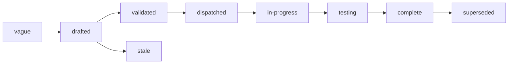

# Specs

Design specs for Examen, a service that runs experiments on agents and
on programs built on models: it runs each combination of task, system
under test, model and environment many times through the services that
run them, or through the owner's own external harness, grades every trial, and
reports outcomes that can be compared, with their noise and confounds
stated, and lets people share what it measured.
One spec covers one component. Each states the problem, the design with
enough precision to build from, and acceptance criteria that are
testable statements. Spec 001 fixes the architecture every other spec
assumes; read it first.

## Layout

Flat files `specs/NNN-name.md` in one number space with `track: core`
in the frontmatter. Numbers are stable identifiers and are never
reused. Open specs sit here and are the work queue. A terminal spec
moves to `specs/.archive/` keeping its number so `depends_on` paths
still resolve.

## Index

| Spec | Status | What it fixes |
|---|---|---|
| [001 Architecture](001-architecture.md) | in-progress | the thin core, the cores it composes, how an experiment executes, the decisions, and the spec index |
| [002 Objects](002-objects.md) | in-progress | every object, its fields, states, identifiers and limits |
| [003 API](003-api.md) | in-progress | the contract a client codes against, its errors, and the event sink |
| [004 Identity and authorization](004-identity-and-authorization.md) | in-progress | the authorizer contract, actions, the built-in owner policy, share grants of reading alone and readers who do not sign in, acting as the owner, the key source and its budget figures |
| [005 Execution](005-execution.md) | in-progress | the executor contract, the `topos`, `cella` and `external` executors, task inputs and references, the HTTP runner, the check sandbox, smoke and the cost check, task-by-task and interleaved scheduling and the lease order, retries and retrying a parked cell, cancellation, imported trials and external past trials, an API's own cost |
| [006 Grading](006-grading.md) | in-progress | checks, the built-in comparators, model judges and the directory outputs they read, candidate-level judges, agent judges, annotations, the decline judge, generations, open vocabularies and their taxonomies, calibration |
| [007 Measurements and evidence](007-measurements-and-evidence.md) | in-progress | the measurement store, provenance layers, evidence references and where evidence lives, retention, dataset export |
| [008 Analysis](008-analysis.md) | in-progress | aggregation and intervals by metric level, studentized permutation tests and the label tests, the stratified label test, the repeat rate, score intervals for weighted rates, the primary result, exploratory comparisons and the corrected family, declared comparisons over cell variables corrected together and the experiment's test of independence, comparisons across batches and their anchors, confounds, automatic comparisons, verdicts, reasons and the power floor, a benchmark's rank intervals, trends |
| [009 Bars](009-bars.md) | drafted | bar rules, evaluation, release use, bar events |
| [010 Reports](010-reports.md) | in-progress | what a console reads and shows, the report document, export |
| [011 Distribution](011-distribution.md) | in-progress | the binary, configuration, Postgres, upgrades, versioning |
| [012 Security](012-security-and-threat-model.md) | in-progress | untrusted task content, judges reading hostile output, references hidden from the system under test, credentials given to programs, external harnesses, cost exhaustion, evidence privacy, published evidence served for download only, and readers without sign-in |
| [013 Publishing](013-publishing.md) | drafted | the one definition of sharing: share grants of reading alone, links and listings; reports, benchmarks and datasets as published snapshots, evidence levels and the secret scan, Arca links, reads without sign-in, open benchmarks with their submissions and results, withdrawal, pause, attribution |

## Build order

The first consumer is a person comparing agents in a console (spec
001, decision 16), and the console follows the API it reads. The first
release, v0.1, serves the v0.1 profile: what an installation runs with
no owner token source, no key source and no file store (spec 003). The
rest follows in this order. v0.1.0 also serves the baseline routes and
the taxonomy routes of later steps, and the Outcome of each spec in
progress says what of it is built.

| Step | What is built |
|---|---|
| v0.1: the v0.1 profile, released in v0.1.0 | 002 objects; 003 the versioned objects, experiments of `external` candidates in modes `execute` and `import` with their grid, cells, trials, measurements, comparisons and rows, comparisons on request, the progress stream, the lease, renewal and submit routes and the import of past trials, and the error table; 004 the authorizer and the owner policy, without sharing, a minter, token files or a key source; 005 the `external` executor with smoke trials, a cost check that leases nothing for a zero estimate, a task's candidates interleaved and cell retries, external past trials with their declared `harness_version` and image, outputs recorded as `arca` references, and cost `unknown`; 007 measurements, self-reported values and evidence references; 008 analysis, with automatic comparisons, comparisons across tasks, declared provenance and the `self_reported`, `declared.image` and `window` confounds; 010 what a console reads, without the calibration column, the gap map and trends; 011 the binary, its configuration and the profile |
| declared comparisons and interleaved scheduling, released in v0.3.0 | 002 an experiment's `comparisons` and `scheduling`, a comparison's `declared`, the declared analysis and `MAX_DECLARED_COMPARISONS`; 003 their create members, `GET /experiments/{id}/declared`, the `declared` filter and a lease that names no candidate; 005 interleaved scheduling across tasks and the lease order; 008 declared comparisons, their family and the declared analysis; 004 and 013 every share a grant of reading, so an experiment runs only on its owner's suite |
| the console section | 003 the baseline routes; a console's section is a client of the API and ships apart (spec 010) |
| the `topos` executor | 005 the `topos` executor once Topos's rollout exists, with spec 005's Topos requirements |
| checks and judges | 004 the minter and the `endpoint` key source; 005 the check sandbox on a single Cella sandbox, task `inputs`, `reference` and `outputs` in the file store, outputs read and written with the output manifest, and costs read from Lux; 006 checks, model judges with the directory outputs they read file by file, and a suite's decline judge; 003 re-grade and the event sink's delivery |
| built-in comparators | 002 and 003 a check grader's `image`; 005 their delivery, with spec 005's Topos requirements R8, R9 and R15, and checks that name an `image` waiting for Cella's image Volumes; 006 the comparators and the comparator image |
| label tests, released in v0.5.0 with declarations over cell variables | 008 the label tests, the stratified label test as a label result's suite-level test and the experiment's test of independence of any cell variable with its `independence` member (002, 003), declared comparisons of the general form over cell variables and a task's `factors` (002, 003, 008), the calibration every comparison reads (006), the cell-level `repeat_rate`, with `mode_share` and `distinct_count` descriptive, and `exclude_labels`, descriptive candidate-level results, the `uncalibrated` confound, and `applies_to`; 002 open vocabularies and metric levels; 003 the taxonomy routes; 006 taxonomies, the canonicalizer and candidate-level judges; 007 candidate-level measurements; 010 their display |
| comparisons across batches | 008 batches as a cell variable and the anchor rule, after the label tests step |
| bars | 009 |
| dataset export | 007 |
| publishing | 013; 002 publications; 003 the report, publication, share and public routes; 004 their actions and share grants; 010 reports and their document; 011 the scanner image and the file store's download-only declaration; then 002 submissions, 003 the submission and results routes and 008 a benchmark's rank intervals |
| agent judges and annotations | 006; 010 the calibration column |
| imported trials | 005 sessions and sandboxes |
| the `cella` executor | 005 the `cella` executor once Cella's SandboxSet exists, with the `program` kind, its checks in the check sandbox, its credentials (004 `credential_audiences`) and the HTTP runner; 008 the `observed.service_versions` confound |
| adoption | 005; 008's `window` confound then covers adopted trials |
| the `lux` key source and token files | 004, for an installation run by one owner |
| the gap map and trends | 008 trends; 010 the gap map and trends |
| the cross-architecture check | 008: the golden comparison run on amd64 and arm64 in CI |
| static report exports | 010 the narrative's draft, its linter and the exports |
