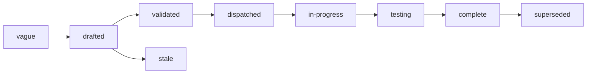

# Specs

Design specs for Examen, a service that runs experiments on agents and
on programs built on models: it runs each combination of task, system
under test, model and environment many times through the services that
run them, or through the owner's own harness, grades every trial, and
reports outcomes that can be compared, with their noise and confounds
stated, and lets people share what it measured.
One spec covers one component. Each states the problem, the design with
enough precision to build from, and acceptance criteria that are
testable statements. Spec 001 fixes the architecture every other spec
assumes; read it first.

## Layout

Flat files `specs/NNN-name.md` in one number space with `track: core`
in the frontmatter. Numbers are stable identifiers and are never
reused. Open specs sit here and are the work queue. A terminal spec
moves to `specs/.archive/` keeping its number so `depends_on` paths
still resolve.

## Index

| Spec | Status | What it fixes |
|---|---|---|
| [001 Architecture](001-architecture.md) | drafted | the thin core, the cores it composes, how an experiment executes, the decisions, and the spec index |
| [002 Objects](002-objects.md) | drafted | every object, its fields, states, identifiers and limits |
| [003 API](003-api.md) | drafted | the contract a client codes against, its errors, and the event sink |
| [004 Identity and authorization](004-identity-and-authorization.md) | drafted | the authorizer contract, actions, the built-in owner policy, share grants and readers who do not sign in, acting as the owner, the key source and its budget figures |
| [005 Execution](005-execution.md) | drafted | the executor contract, the `topos`, `cella` and `external` executors, task inputs and references, the HTTP runner, the check sandbox, smoke and the cost check, retries and retrying a parked cell, cancellation, imported trials and external past runs, an API's own cost |
| [006 Grading](006-grading.md) | drafted | checks, the built-in comparators, model judges, candidate-level judges, agent judges, annotations, the decline judge, generations, open vocabularies and their taxonomies, calibration |
| [007 Measurements and evidence](007-measurements-and-evidence.md) | drafted | the measurement store, provenance layers, evidence references and where evidence lives, retention, dataset export |
| [008 Analysis](008-analysis.md) | drafted | aggregation and intervals by metric level, studentized permutation tests and the label tests, the repeat rate, score intervals for weighted rates, the primary result, exploratory comparisons and the corrected family, confounds, automatic comparisons, verdicts, reasons and the power floor, a benchmark's rank intervals, trends |
| [009 Bars](009-bars.md) | drafted | bar rules, evaluation, release use, bar events |
| [010 Reports](010-reports.md) | drafted | what a console reads and shows, the report document, export |
| [011 Distribution](011-distribution.md) | drafted | the binary, configuration, Postgres, upgrades, versioning |
| [012 Security](012-security-and-threat-model.md) | drafted | untrusted task content, judges reading hostile output, references hidden from the system under test, credentials given to programs, external harnesses, cost exhaustion, evidence privacy, published evidence served for download only, and readers without sign-in |
| [013 Publishing](013-publishing.md) | drafted | the one definition of sharing: share grants, links and listings; reports, benchmarks and datasets as published snapshots, evidence levels and the secret scan, Arca links, reads without sign-in, open benchmarks with their submissions and results, withdrawal, pause, attribution |

## Build order

The first consumer is a person comparing agents in a console (spec
001, decision 16), so the first slice is the path a comparison needs,
and the rest follows in this order.

| Step | What is built |
|---|---|
| first slice | 002 objects; 003 the routes the console path needs, the progress stream and the event sink; 004 without sharing, with both key sources; 005 the `topos` executor with smoke trials, the cost check, interleaved scheduling and cell retries; 006 checks, model judges and the decline judge; 007 measurements and evidence; 008 analysis, with automatic comparisons, the `window` confound and descriptive label results; 010 what a console reads and shows, without the calibration column, the gap map and trends |
| built-in comparators | 002 and 003 task `inputs`, `reference` and `outputs`, and a check grader's `image`; 005 their delivery, with spec 005's Topos requirements R8, R9 and R15; 006 the comparators and the comparator image |
| the `external` executor | 003 the lease and submit routes; 004 `trial.lease` and `trial.submit`; 005 the `external` executor and the check sandbox on a single Cella sandbox, built today, with checks that name an `image` waiting for Cella's image Volumes; 007 self-reported values; 008 declared provenance and the `self_reported` confound; 010 their display |
| label tests | 008 the label tests, the cell-level `repeat_rate`, with `mode_share` and `distinct_count` descriptive, and `exclude_labels`, descriptive candidate-level results, the `uncalibrated` confound, and `applies_to`; 002 open vocabularies and metric levels; 003 the taxonomy routes; 006 taxonomies, the canonicalizer and candidate-level judges; 007 candidate-level measurements; 010 their display |
| history import | 003 and 005 external past runs in mode `import`, with their declared harness version and image, directory outputs as archives with the output manifest, external candidates' declared model, reasoning and flags, and cost `unknown`; 008 the `declared.image` confound and comparisons across tasks |
| bars | 009 |
| dataset export | 007 |
| publishing | 013; 002 publications and submissions; 003 the report, publication, submission, share and public routes; 004 their actions and share grants; 010 reports and their document; 011 the scanner image and the file store's download-only declaration |
| agent judges and annotations | 006; 010 the calibration column |
| imported trials | 005 sessions and sandboxes |
| the `cella` executor | 005 the `cella` executor once Cella's SandboxSet exists, with the `program` kind, its checks in the check sandbox, its credentials (004 `credential_audiences`) and the HTTP runner; 008 the `observed.service_versions` confound |
| adoption | 005; 008's `window` confound then covers adopted trials |
| the gap map and trends | 008 trends; 010 the gap map and trends |
| the cross-architecture check | 008: the golden comparison run on amd64 and arm64 in CI |
| static report exports | 010 the narrative and its linter, and the exports |
