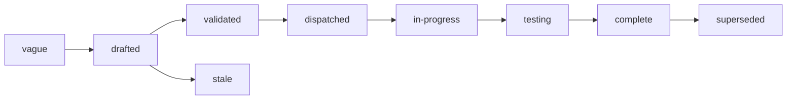

# Specs

Design specs for Examen, a service that runs experiments on agents: it
runs each combination of task, agent, model and environment many times
through the services that run them, grades every run, and reports
outcomes that can be compared, with their noise and confounds stated.
One spec covers one component. Each states the problem, the design with
enough precision to build from, and acceptance criteria that are
testable statements. Spec 001 fixes the architecture every other spec
assumes; read it first.

## Layout

Flat files `specs/NNN-name.md` in one number space with `track: core`
in the frontmatter. Numbers are stable identifiers and are never
reused. Open specs sit here and are the work queue. A terminal spec
moves to `specs/.archive/` keeping its number so `depends_on` paths
still resolve.

## Index

| Spec | Status | What it fixes |
|---|---|---|
| [001 Architecture](001-architecture.md) | drafted | the objects, the provenance tuple, the principles, how a run executes, and the interfaces Examen depends on |

## Build order

The specs that follow 001, in the order they are written and built. Each
is a number reserved for its component; none is written yet.

| Spec | Component |
|---|---|
| 002 | Objects: suite, task, cell, run, grade, comparison; fields, states, identifiers |
| 003 | API: the contract a client codes against, and its errors |
| 004 | Identity and authorization: the authorizer contract and the built-in owner policy |
| 005 | Runner: starting, following and ending sessions; budgets, retries, smoke runs |
| 006 | Evidence: what is copied from a run and where it is kept |
| 007 | Graders: deterministic graders, pinned judges, generations, calibration |
| 008 | Comparisons and noise: confounds, noise floors, gates |
| 009 | Reports: what a report contains and how it is exported |
