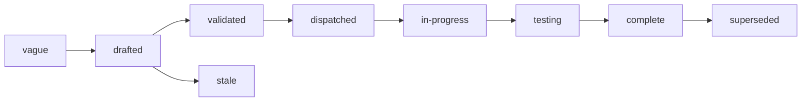

# Specs

Design specs for Examen, a service that runs experiments on agents: it
runs each combination of task, agent, model and environment many times
through the services that run them, grades every trial, and reports
outcomes that can be compared, with their noise and confounds stated.
One spec covers one component. Each states the problem, the design with
enough precision to build from, and acceptance criteria that are
testable statements. Spec 001 fixes the architecture every other spec
assumes; read it first.

## Layout

Flat files `specs/NNN-name.md` in one number space with `track: core`
in the frontmatter. Numbers are stable identifiers and are never
reused. Open specs sit here and are the work queue. A terminal spec
moves to `specs/.archive/` keeping its number so `depends_on` paths
still resolve.

## Index

| Spec | Status | What it fixes |
|---|---|---|
| [001 Architecture](001-architecture.md) | drafted | the thin core, the cores it composes, how an experiment executes, the decisions, and the spec index |
| [002 Objects](002-objects.md) | drafted | every object, its fields, states, identifiers and limits |
| [003 API](003-api.md) | drafted | the contract a client codes against, and its errors |
| [004 Identity and authorization](004-identity-and-authorization.md) | drafted | the authorizer contract, actions, the built-in owner policy, sharing, acting as the owner |
| [005 Execution](005-execution.md) | drafted | the executor contract, the `topos` and `cella` executors, smoke, budget, retries, cancellation, imported trials |
| [006 Grading](006-grading.md) | drafted | checks, model judges, agent judges, annotations, the decline judge, generations, calibration |
| [007 Measurements and evidence](007-measurements-and-evidence.md) | drafted | the measurement store, provenance layers, evidence references, retention, dataset export |
| [008 Analysis](008-analysis.md) | drafted | aggregation, noise floors, tests, multiple comparisons, confounds, baselines, verdicts, trends |
| [009 Bars](009-bars.md) | drafted | bar rules, evaluation, release use, alerts |
| [010 Reports](010-reports.md) | drafted | the console view, what a report shows, export, sharing |
| [011 Distribution](011-distribution.md) | drafted | the binary, configuration, Postgres, upgrades, versioning |
| [012 Security](012-security-and-threat-model.md) | drafted | untrusted task content, judges reading hostile output, cost exhaustion, evidence privacy |

## Build order

The first consumer is a person comparing agents in a console (spec
001, decision 16), so the first slice is the path a comparison needs,
and the rest follows in this order.

| Step | What is built |
|---|---|
| first slice | 002 objects; 003 the API's read side for the console; 004; 005 the `topos` executor with smoke trials and the budget gate; 006 checks, model judges and the decline judge; 007 measurements and evidence; 008 analysis; 010 the console view |
| bars | 009 |
| dataset export | 007 |
| agent judges and annotations | 006 |
| imported trials | 005 |
| the `cella` executor | 005 |
| static report exports | 010 |
